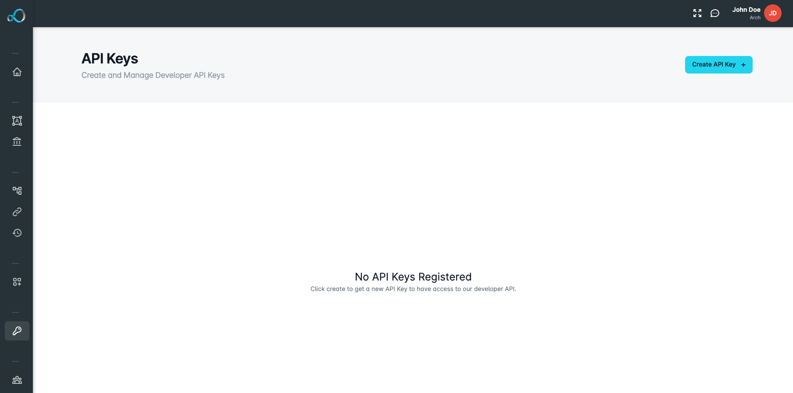

# Developer API Overview

## Introduction

Explore Looply developer APIs - powerful tools that empower developers to seamlessly interact with Looply's functionality.&#x20;


[workflow-api.md](workflow-api.md)


## API Keys

Developers can view existing API keys or generate new ones directly from the Looply dashboard **Developer Tools** section. &#x20;

Dive into a refined space where precision meets access control, ensuring your development team has the credentials needed for a seamless integration experience.

<figure><figcaption></figcaption></figure>

#### Generating API Keys

Get started by generating a new API key for your team directly from the **API Keys** page within Looply.&#x20;

Create a new API key by clicking the **Create API Key +** button and providing a name for your key.&#x20;

#### Deleting API Keys

API Keys can be seamlessly removed by clicking on the **trash can** icon located next to the API Key.&#x20;
