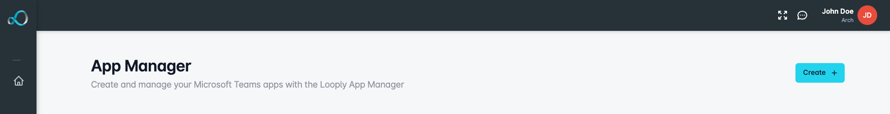
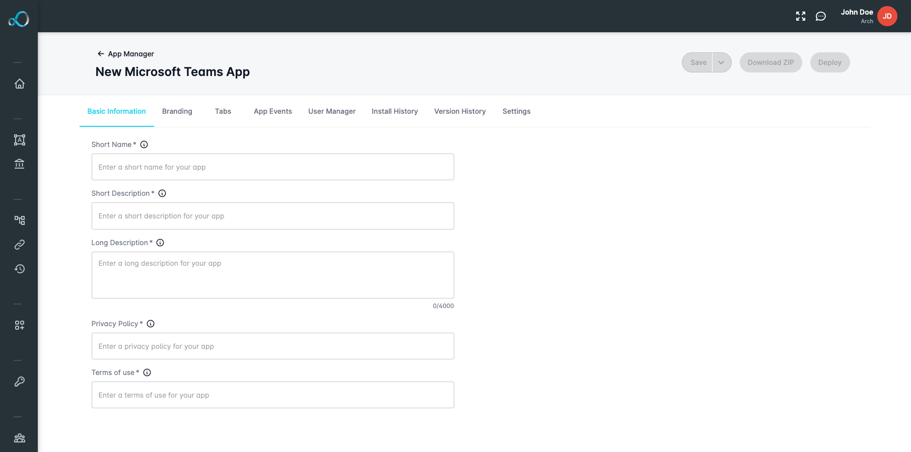
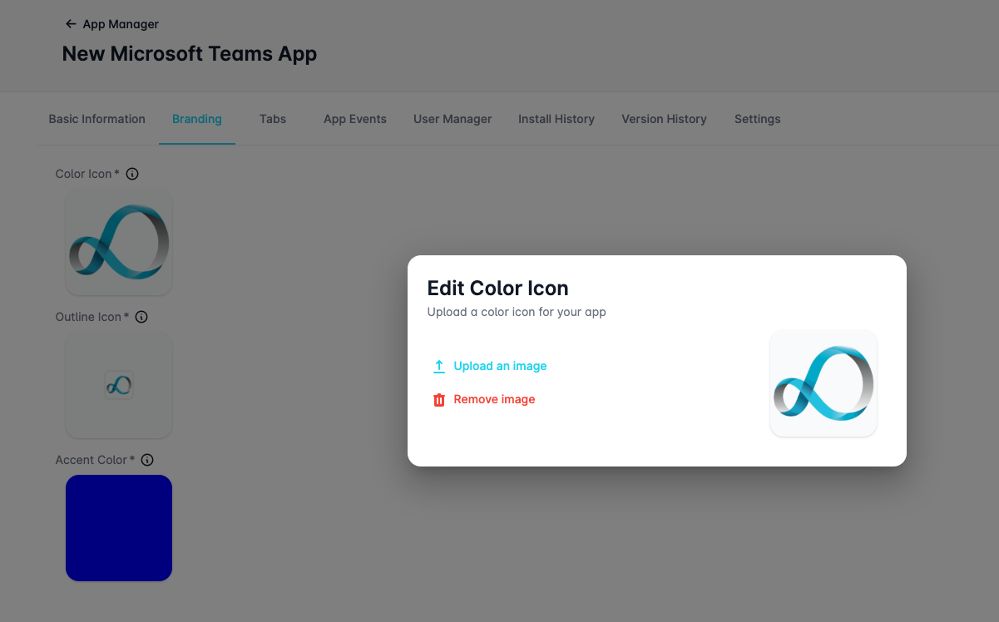
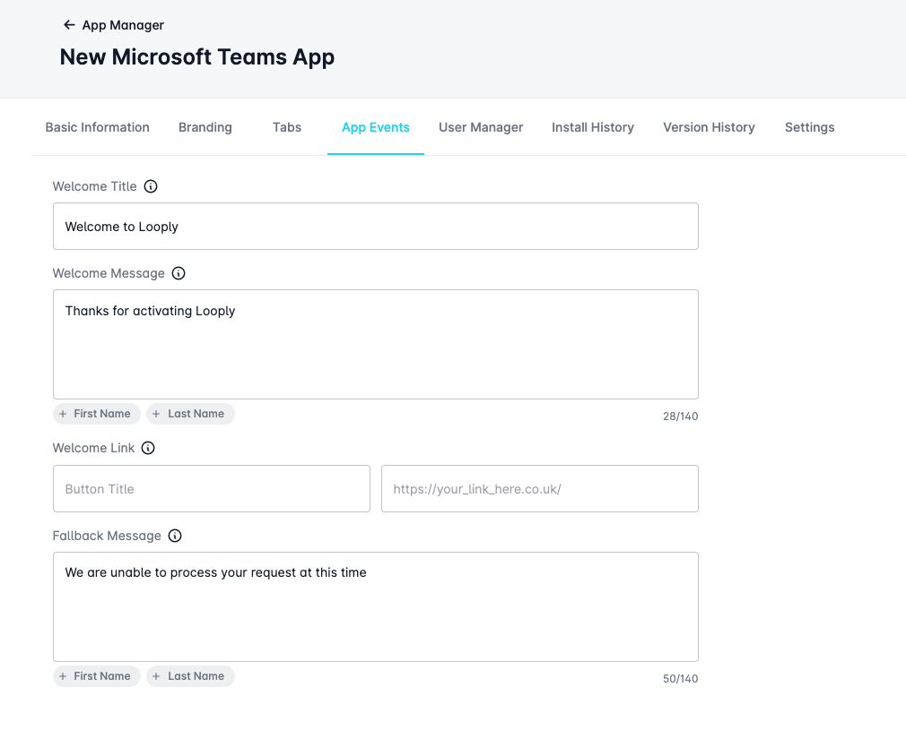
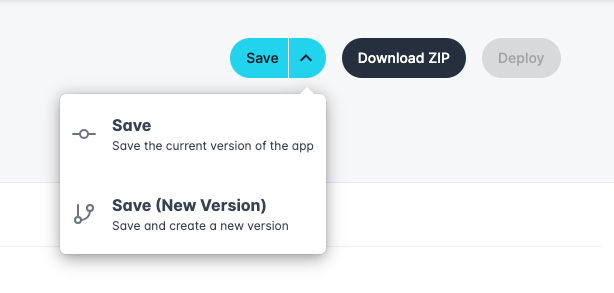

# Building Apps

## Introduction

After integrating your organization's Microsoft tenant with Looply, unlock the full potential of customization by leveraging the Looply App Manager. This powerful tool allows you to effortlessly create custom Microsoft Teams apps that seamlessly integrate into your Teams landscape. These tailor-made apps serve as the bridge connecting your meticulously crafted workflows with your users, ensuring a cohesive and efficient collaboration experience within Microsoft Teams.

A Microsoft Teams app, within the Looply ecosystem, stands as a versatile extension that amplifies the collaborative capabilities of your Teams environment. These apps, crafted using the Looply App Manager, serve as specialized tools designed to augment your organization's workflows and communication within Microsoft Teams.

## Creating a new app

You can begin creating a new MS Team app by selecting the App Manager and clicking the **Create** button.&#x20;

<figure><figcaption></figcaption></figure>

### Basic Information

Start creating your custom MS Teams app by adding some basic information that will describe your app to your Teams users.&#x20;

You can add a short name, description, and a longer description for your Teams app. There is also space to add links to your organisation's privacy policy and terms of use documents.&#x20;

<figure><figcaption></figcaption></figure>

### Adding Custom Branding

You can use the **Branding** tab to customise the branding of your Teams app to match your organisation.&#x20;

The branding options supported by Looply are:&#x20;

* **Color Icon** - 192x192px full-color image to be displayed as the main logo of your app
* **Outline Icon** - 36x36px (recommended white or transparent) icon to be used within the Teams sidebar
* **Accent Color** - a single solid color to be used as the accent and displayed within messages

<figure><figcaption></figcaption></figure>

### Configure App Tabs

Use the **Tabs** section to add up to 3 custom links; accessible for your users from within your app in Teams as individual tabs.&#x20;

These can be used to attach useful information pages or links relevant to your users.&#x20;

By default, all Teams apps will feature tabs for Chat, About and Notifications Centre - these cannot be modified or removed. You can add a new custom tab by clicking the **New Tab** button and, entering a display name and URL for your custom tab link.&#x20;

<figure><figcaption></figcaption></figure>


**Note:** Make sure to include any custom URLs you want your Teams app to link to within your app's domain whitelist located in the **Settings** section.&#x20;

Attempting to attach links to external URLs not included in your whitelist will result in an error.&#x20;


### Handling App Events

You can use the **App Events** tab to define how your Teams app should react to specific user events.&#x20;

<figure><figcaption></figcaption></figure>


**Note:** We currently only support **Welcome** and **Fallback** events within your Teams apps.&#x20;


#### Welcome Events

A welcome event occurs when a user installs your Teams app for the first time. When this happens, you might want to send them a customised onboarding message and/or link to help them get started.

Configure your welcome event by entering a welcome message title, body, and link which will be displayed as a button link within Teams.&#x20;

Welcome messages support up to 140 characters and can be personalised with your user's first or last name - which can be inserted by clicking on either the **First Name** or **Last Name** icon buttons while your cursor is active in the text field.&#x20;

#### Fallback Events

A fallback event can be triggered when your user attempts to perform an action that is not permitted by your Teams app.&#x20;

For example, a fallback event would be triggered if your user sends a chat message to your Teams app that is not recognised.&#x20;

You can enter a message that will be sent to the user (up to 140 characters) when this exception occurs.&#x20;

## Saving your changes

Once you have added or modified some information for your Teams app, you can save your changes by clicking the **Save** button.&#x20;

Saving your changes for the first time will create a new Teams app within your workspace on Looply. Subsequently, saving changes after this point will update the existing app.&#x20;

A status for your Teams app will be determined or redetermined every time you save your app. See App Statuses to learn more about the different statuses of your app.&#x20;

### Version Control

Enjoy the assurance of version control as you create Microsoft Teams apps with Looply, ensuring that each iteration is seamlessly tracked and documented for a transparent and organized development process.

#### Creating New Versions

When you create an app for the first time, it will be assigned as the first version. You can modify the current version of your app as many times as you wish until that version has been deployed.&#x20;

Once a version has been deployed within your landscape it becomes locked from further changes to prevent potentially system-breaking changes from accidentally going live. If you attempt to make changes after this point and click Save, your Teams app will **automatically create a new version** for you and will not be live until that version is deployed.&#x20;

Additionally, you can choose to manually create a new version of your app at any time by clicking the dropdown arrow located on the Save button and selecting the **Save (New Version)** option.&#x20;

<figure><figcaption></figcaption></figure>

#### Viewing Version History

The **Version History** tab can be used to view previously created versions of your Teams app. Users can select previous versions by clicking on the version number of a previous version to load it. T

his can be useful for restoring older versions, by selecting the version you want to restore and then saving/re-deploying that version.&#x20;
