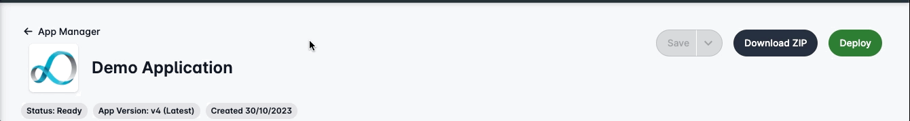
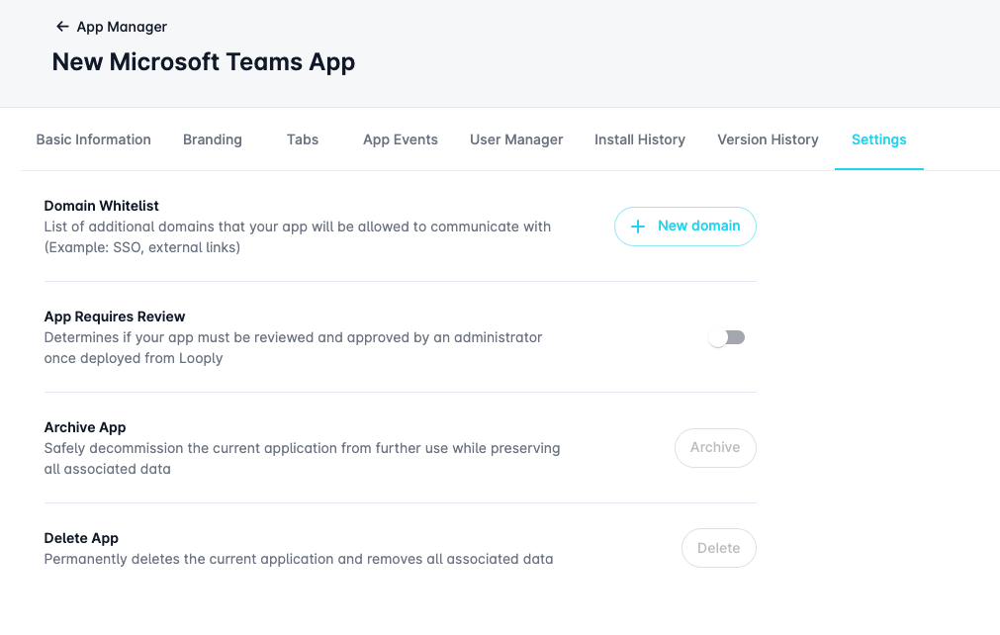

# Looply Dashboard

Once you have created your Teams app using Looply, you'll need to deploy it to your organisations Microsoft landscape in order to make it available for your users to install and unlock remote app management.&#x20;

### Quick Deployment


**Note:** You will need to integrate a Microsoft account from your organisation that has the appropriate privileges required to publish a new app to your landscape with Looply before continuing.&#x20;


Versions of your Teams app can be seamlessly deployed to your Microsoft organisation once they have been populated with all required information and in the **Ready** status.&#x20;

To deploy your app, Go to **App Manager** -> click the **Deploy** button located at the top of the Create/Edit app page.&#x20;

<figure><figcaption></figcaption></figure>

You'll need to confirm which Microsoft integrated account you wish to use for deployment by selecting it and clicking **Deploy** again in the side panel.&#x20;

If you can't see the correct Microsoft account within the side panel window, we recommend disconnecting and re-connecting your integration.&#x20;

Once your deployment is complete, you can verify it has worked correctly by going to Microsoft Teams and viewing the integrated app catalog.&#x20;

### Forcing Admin Approval

Looply supports the ability to force your custom Teams app to require approval from an organisation administrator when deployed in your Microsoft 365 landscape.

This feature ensures that every app package sent from Looply must be explicitly reviewed and approved before being made available to end users.

This safeguard is especially useful in environments where:

* You need a change-control step before allowing production use
* Your organisation follows strict IT governance
* A separate security or compliance team must authorise all internal apps
* You want to prevent unapproved versions from being distributed automatically

You can enable this functionality by toggling the **App Requires Review** switch on from within the **Settings** tab of the Teams app you are creating or editing.&#x20;

<figure><figcaption></figcaption></figure>

When this toggle is enabled, Looply instructs Microsoft Graph to deploy the app using the **requiresReview=true** flag.

This means the app will not be published directly to the Teams app catalog — instead, it is submitted for admin review inside your Microsoft tenant.

### Approving Custom Apps in the Teams Admin Center

When Looply deploys an app with App Requires Review enabled, the app will appear in Microsoft Teams as “Needs approval”. A Teams administrator must approve it before it becomes available to users.

Follow these steps:

1\. Open the Teams Admin Center

Go to: https://admin.teams.microsoft.com

Sign in with one of the following roles:

* Teams Administrator
* Teams App Administrator
* Global Administrator

2\. Go to Manage Apps

In the left menu: Teams apps → Manage apps

3\. Locate the Pending App

Use one of the following:

* Search for the app name

4\. Publish or Reject

Select the app → choose Publish (or Reject).

Publish action deploys the app to your Organisation’s, making it available for installation and use by Looply workflows.

5\. App Goes Live

Once approved:

* The app moves to the Published list
* Users can install it (subject to policies)
* Looply can use it for adaptive cards and workflow actions

#### What Happens If “Requires Review” Is Disabled?

If you turn off the App Requires Review toggle in Looply:

* The app will be published immediately to the Organisation catalog
* No admin approval step is needed
* Only the standard Teams permission policies control user access
* Deployment is instant, suitable for rapid development environments
