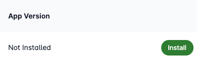

# Installing Looply Apps

Looply respects the need for central control. Organisational administrators can remotely install/uninstall/update the app for users, ensuring uniformity in app versions and features across the board.


**Note:** This feature is only available for Looply **administrators** and requires your Teams app to have been deployed on your landscape.&#x20;


#### Individual Users

* Go to **App Manager** from the side navigation menu
* Click on the App tile to deploy the app to the required users
* Go to **User Manager** tab
* Search for the user using their email address
* Click Install

<figure><figcaption>
App manager
</figcaption></figure>


Note: App can only be installed to users after the app has been deployed to the organizational app catalog. Please refer to deploying apps to Teams app catalog for details.&#x20;


You can remotely manage your Teams app for individual users via the **User Manager** tab when creating or editing an app. From here, you can view all of the users within your Microsoft organisation and each of their installation statuses of your app.&#x20;

<figure><figcaption>
User Manager 
</figcaption></figure>

You can install or uninstall the selected version of your app for a specific user by clicking **Install** or **Uninstall** beside the user's account information within the table. Additionally, if the user has an older version of the app installed - you can force an update to the current selected version.&#x20;

<figure><figcaption></figcaption></figure>

#### Installation History

All details about who has installed your Teams app are logged under the **Installation History** tab. From here, you'll be able to see a list of users, the date of installation, the version installed, and the installation type (personal, group chat, or channel).&#x20;

<figure><figcaption></figcaption></figure>
