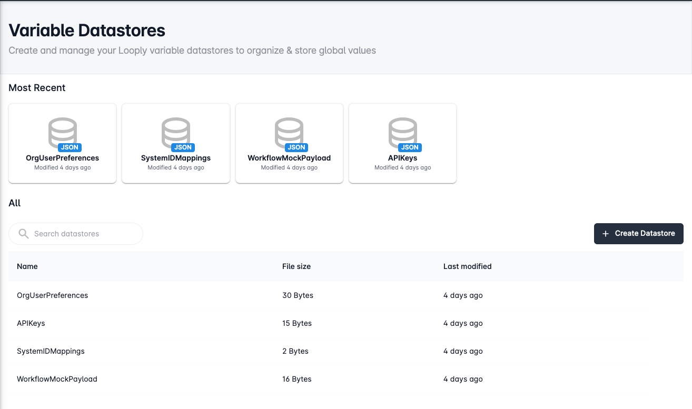
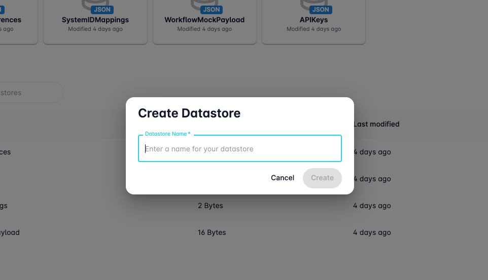

# Variable Datastores

Looply's **Variable Datastore** is a flexible storage solution designed to help you manage and reuse custom JSON data across your workflows. Whether you're working with large datasets or simply need a central place to store structured information, variable datastores make it easy to create, access, and maintain object-based data within the Looply platform. By storing your JSON data in a datastore, you can reference it in multiple workflows, reduce duplication, and keep your logic clean and maintainable.

<figure><figcaption></figcaption></figure>

## Creating Datastores

You can get started creating datastores by navigating to the Looply Variable Datastore tool and clicking **+ Create Datastore**.&#x20;

<figure><figcaption></figcaption></figure>

Once the Create Datastore dialog opens, simply give your datastore a unique name which can be used to identify your storage object and click **Create**.&#x20;

## Editing Data

Once you've created a Variable Datastore in Looply, you can easily add, view, and modify its content directly through the **Datastore Editor** interface.

<figure><figcaption></figcaption></figure>

### Editing JSON Data

On the right-hand side of the editor, you'll see a formatted JSON editor where you can directly input or update your datastore contents. This is where you define your key structure and values—such as arrays, objects, strings, or numbers—based on how your workflows need to use the data.

For example, in a datastore like `LineManagerData`, you might store an array of line manager objects, each with fields like `id`, `name`, `email`, `department`, and a list of `reports`.

The JSON editor supports syntax highlighting and formatting, making it easy to edit structured data at scale. Use the **Format** button at the top to automatically tidy up your structure, and **Save** your changes once you're ready.

### Browsing and Editing Properties

On the left-hand side, the **Properties** panel provides a more visual breakdown of the current datastore structure. Each nested object and value is displayed in a readable format, allowing you to quickly inspect or navigate your data—especially useful for larger or deeply nested datasets.

### Datastore Settings

<figure><figcaption></figcaption></figure>

Click the **Datastore Settings** tab to view metadata such as:

* Datastore name
* File size
* Created and last modified dates
* (Coming Soon) Encryption toggle for securing sensitive data

While encryption is not currently available, this setting will soon allow you to protect your datastore content with a simple toggle.

## Deleting a Datastore


**Note:** This action cannot be undone. Be sure to back up any important data before deleting.


If you no longer need a datastore, you can permanently delete it from the **Datastore Settings** tab. This action is irreversible, so proceed with caution.

<figure><figcaption></figcaption></figure>

To delete a datastore:

1. Navigate to the **Datastore Settings** tab of the datastore you wish to remove.
2. Click the **Delete datastore** button.
3. A confirmation dialog will appear, asking you to manually type the name of the datastore (e.g. `LineManagerData`) to confirm the deletion.
4. Once the correct name is entered, the **Delete datastore** button will become active.
5. Click it to permanently remove the datastore and all of its content.

## Using Datastores in Workflows

Variable Datastores can be easily integrated into your workflows to provide reusable data across steps—ideal for things like configuration values, reference mappings, or shared resources like `LineManagerData`.

### Adding a Datastore to a Workflow

<figure><figcaption></figcaption></figure>

To use a datastore in a workflow:

1. Open your workflow in the **Workflow Studio**.
2. Click the **overflow menu (⋮)** at the top right of the workflow canvas.
3. Select **Datastores** from the dropdown.
4. From the **Active Datastores** popup, select one or more datastores you want to use in this workflow (e.g., `LineManagerData`).
5. Click **Save** to confirm your selection.

The selected datastores will now be bound to the current workflow and available for use within each step.

### Accessing Datastore Data in Steps

Once a datastore is attached to a workflow, its contents are automatically available in the **data binding menu** of each workflow step.

<figure><figcaption></figcaption></figure>

When configuring a step (such as a function, condition, or integration call), click into the parameters or input fields and select values from the datastore—these will appear in the selection menu with their names and structure clearly outlined. For example:

* `datastore_id` → the unique ID of the datastore
* `line_managers` → the full array of line manager objects

This allows you to pass datastore data into functions, reference it in conditional logic, or enrich outbound payloads using structured and centralised data.

