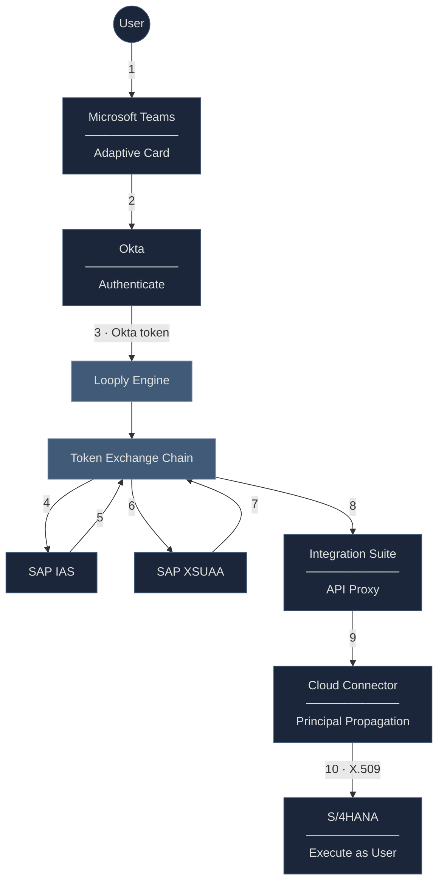

# Deprecated::SSO Setup Guide: Okta → SAP Integration

This guide walks you through configuring Single Sign-On (SSO) for Looply workflows that connect to SAP systems. By the end of this setup, your users actioning workflows via adaptive card on microsoft Teams will authenticate once through Okta and seamlessly access SAP with their own identity preserved.

***

### How It Works

> 💡 **Quick Start Guide**
>
> Depending on your existing setup, you may be able to skip certain sections:

When a user triggers a Looply workflow that needs SAP access, their identity flows securely from Okta through SAP's cloud services to your on-premise SAP system.

**What this means for you:**

* Users log in once with their existing Okta credentials
* SAP sees the actual user making the request (not a technical account)
* Full audit trail of who did what in SAP
* No custom code required—just configuration

Looply's **Token Exchange Chain** handles the complex authentication handoffs automatically. You configure the integration profiles once, and Looply orchestrates everything at runtime.



**The result:** When a user clicks an action in Teams, they authenticate once through Okta. The Looply Engine then securely propagates their identity through SAP's cloud services, so the SAP backend sees the actual user (e.g., `john.smith@company.com`)—enabling proper authorization checks, audit logging, and user-specific data access.

***

### Prerequisites

Before starting, confirm you have:

| Component      | Requirements                                                         |
| -------------- | -------------------------------------------------------------------- |
| **Okta**       | Admin access to create OAuth2 applications                           |
| **SAP IAS**    | Admin access to your Identity Authentication tenant                  |
| **SAP BTP**    | Subaccount with Authorization & Trust Management (XSUAA) entitlement |
| **SAP System** | Basis administrator access for certificate and login configuration   |
| **Users**      | Email addresses in Okta must match email addresses in SAP            |

***

### Part 1: SAP Identity Authentication Service (IAS) Setup

IAS acts as the bridge between your corporate identity provider (Okta) and SAP BTP services.

#### Step 1.1: Configure Okta as Corporate Identity Provider

> **Already configured?** If Okta is already set up as a Corporate Identity Provider in your IAS tenant, skip to Step 1.2. You can verify this in IAS Admin Console → Identity Providers → Corporate Identity Providers.

1. Log into your **IAS Admin Console**
2. Navigate to **Identity Providers** → **Corporate Identity Providers**
3. Click **Create** → Select **OpenID Connect**
4. Enter the following configuration:

| Field         | Value                                                         |
| ------------- | ------------------------------------------------------------- |
| Name          | `Okta`                                                        |
| Discovery URL | `https://<your-okta-domain>/.well-known/openid-configuration` |
| Client ID     | _(Your Okta application's Client ID)_                         |
| Client Secret | _(Your Okta application's Client Secret)_                     |

5. Under **Subject Name Identifier**, select **email**
6. Click **Save** and set to **Active**

#### Step 1.2: Create OIDC Application for Token Exchange

> **Already have an OIDC application?** If you have an existing IAS application configured for JWT Bearer grants, you can reuse it. Ensure it has Okta enabled under Trusted Identity Providers and note the Client ID/Secret for Looply.


When a custom IAS tenant is linked/trusted by a SAP BTP sub account, an OIDC application with the following ID: **XSUAA\_\<BTP sub account ID>** is automatically created by SAP BTP provisioning service. If this application already exists, Skip the Step 1.2


**Option A: Use the Auto-Created XSUAA Application (Recommended)**

1. In IAS Admin Console, go to **Applications & Resources → Applications**
2. Find and select `XSUAA_<your-subaccount-id>`
3. Go to **Conditional Authentication**
4. Under **Default Authenticating Identity Provider**, select **Okta IDP (Corporate IDP)** from the dropdown
5. Click **Save**
6. Go to **Client Authentication**
7. Under **Secrets**, click **+Add** to create a client secret
8. Note the **Client ID** and **Client Secret** for Looply configuration
9. Click **Save**

> ⚠️ **Can't modify the Default Identity Provider?** If the auto-created application is managed by another team or you cannot change the default IdP, use Option B below.

**Option B: Create a Dedicated Looply Application**

Use this approach if you cannot modify the auto-created XSUAA application.

1. In IAS Admin Console, go to **Applications & Resources → Applications**
2. Click **Create** and configure:

| Setting      | Value                                              |
| ------------ | -------------------------------------------------- |
| Display Name | `looply_okta_ias`                                  |
| Home URL     | _(leave blank or enter your Looply workspace URL)_ |

3. After creation, go to **Parent Application**
4. Click **Edit** and select the `XSUAA_<btp subaccount-id>` application as the parent
5. Click **Save**
6. Go to **Conditional Authentication**
7. Under **Default Authenticating Identity Provider**, select **Okta**
8. Uncheck **Allow Identity Authentication Users Log On** (optional—ensures only Okta users can authenticate)
9. Click **Save**
10. Go to **Client Authentication**
11. Under **Secrets**, click **+Add** to create a client secret
12. API Access: Select **openid**
13. Note the **Client ID** and **Client Secret**
14. Click **Save**

**Required Application Settings Checklist**

Regardless of which option you choose, verify these settings:

| Setting                   | Location                        | Required Value                                |
| ------------------------- | ------------------------------- | --------------------------------------------- |
| Default Identity Provider | Conditional Authentication      | **Okta**                                      |
| Client Secret             | Client Authentication → Secrets | Generated and saved                           |
| Subject Name Identifier   | Subject Name Identifier         | **Email** (should inherit from Corporate IdP) |

#### What to Provide to Looply

After completing IAS setup, share these values with your Looply team:

```yaml
ias:
  tenant_url: https://<your-ias-tenant>.accounts.ondemand.com
  token_url: https://<your-ias-tenant>.accounts.ondemand.com/oauth2/token
  client_id: <from-client-authentication>
  client_secret: [provide securely]
```

***

### Part 2: SAP XSUAA Setup

XSUAA (Authorization and Trust Management Service) issues the final OAuth2 token that grants access to SAP APIs (including proxies exposed via SAP Integration suite).

#### Step 2.1: Trust IAS in Your BTP Subaccount

> **Already trusted?** If IAS is already configured as a trusted identity provider in your BTP subaccount, skip to [Step 2.2](https://claude.ai/chat/9316e1e4-f8ef-4972-9d17-c411ef9940f5#step-22-create-xsuaa-service-instance). Check this in BTP Cockpit → Subaccount → Security → Trust Configuration.

1. Log into **SAP BTP Cockpit**
2. Navigate to your Subaccount → **Security** → **Trust Configuration**
3. Click **Establish Trust**
4. Select custom SAP IAS tenant and verify if the custom IAS tenant appears under Custom Identity Provider fro Applications

#### Step 2.2: Create XSUAA Service Instance

> **Already have an XSUAA instance?** If you have an existing XSUAA service instance with the `apiaccess` plan and `jwt-bearer` grant type enabled, you can reuse it. Skip to [Step 2.3](https://claude.ai/chat/9316e1e4-f8ef-4972-9d17-c411ef9940f5#step-23-create-service-key) to generate a new service key for Looply.


If you are unable to create **Authorization and Trust service instance (XSUAA)** without **apiaccess** plan, please check if **cloud foundry** is **enabled** in the BTP subaccount. Also verify if you have the relevant **entitlements** to the required plan assigned.


1. In BTP Cockpit, go to **Service Marketplace**
2. Search for **Authorization and Trust Management Service**
3. Click **Create** and configure:

| Setting       | Value                          |
| ------------- | ------------------------------ |
| Plan          | `apiaccess`                    |
| Instance Name | `looply-principal-propagation` |

#### Step 2.3: Create Service Key

1. After the instance is created, click **Create Service Key**
2. Name: `looply-key`
3. Copy the generated service key JSON

#### What to Provide to Looply

Extract these values from your service key:

```yaml
xsuaa:
  token_url: <url from service key>/oauth/token
  client_id: <clientid from service key>
  client_secret: [provide securely]
```

***

### Part 3: SAP On-Premise Configuration

These steps configure your SAP system to accept certificate-based authentication from Cloud Connector.

> **Already using Principal Propagation?** If your SAP system is already configured for certificate-based authentication with Cloud Connector (e.g., for other BTP integrations), you may only need to verify the existing configuration. Skip to [Step 3.4](https://claude.ai/chat/9316e1e4-f8ef-4972-9d17-c411ef9940f5#step-34-verify-user-email-addresses) to ensure user emails are properly mapped.

#### Step 3.1: Import Cloud Connector CA Certificate (STRUST)

The Cloud Connector generates certificates for each user. SAP must trust this certificate authority.

1. Obtain the CA certificate from Cloud Connector:
   * Cloud Connector Admin → **Principal Propagation** → Export **Local CA Certificate**
2. In SAP, run transaction **STRUST**
3. Navigate to **SSL Server Standard** → **Certificate List**
4. Click **Import Certificate** and upload the Cloud Connector CA
5. Add to the certificate list and **Save**

#### Step 3.2: Import Cloud Connector System Certificate (STRUST)

* Obtain the System certificate from Cloud Connector:
  * Cloud Connector Admin → **Principal Propagation** → Export **System Certificate**
* In SAP, run transaction **STRUST**
* Navigate to **SSL Server Standard** → **Certificate List**
* Click **Import Certificate** and upload the Cloud Connector CA
* Add to the certificate list and **Save**

#### Step 3.3: Configure Certificate-Based Login (RZ10)

1. Run transaction **RZ10**
2. Edit your **instance profile**
3. Add these parameters:

```
icm/HTTPS/trust_client_with_issuer = "*CN=<Your-Cloud-Connector-CA-Name>*"
icm/HTTPS/verify_client = 1
login/certificate_mapping_rulebased = 1
```

4. Save and activate the profile
5. **Restart ICM** (transaction SMICM → Administration → ICM → Restart)

#### Step 3.4: Configure Certificate Mapping (CERTRULE)

This tells SAP how to map the certificate's CN (email) to a SAP user.

1. Run transaction **CERTRULE**
2. Import a sample certificate (from Cloud Connector for testing)
3. Create a new mapping rule:

| Setting         | Value                                 |
| --------------- | ------------------------------------- |
| Rule Attribute  | `Issuer`                              |
| Condition       | `*CN=<Your-Cloud-Connector-CA-Name>*` |
| Login Attribute | `Subject` → `CN`                      |
| Login Type      | `E-Mail (table USREMAIL)`             |

#### Step 3.5: Verify User Email Addresses

**This is critical.** For principal propagation to work, each SAP user must have an email address that **exactly matches** their Okta email.

1. Run transaction **SU01** to check individual users
2. Verify the **E-Mail** field (Address tab) matches the Okta email
3. For bulk verification, use **SE16** to query table **USREMAIL**

> **Note:** Email matching may be case-sensitive depending on your configuration. Ensure consistent casing between Okta and SAP.

***

### Configuration Summary

Once you've completed all steps, gather this information for your Looply implementation team:

| Component           | Information Needed                                       |
| ------------------- | -------------------------------------------------------- |
| **IAS**             | Tenant URL, Token URL, Client ID, Client Secret          |
| **XSUAA**           | Token URL, Client ID, Client Secret (from service key)   |
| **Cloud Connector** | CA Common Name, Subject Pattern                          |
| **User Mapping**    | Confirmation that user emails match between Okta and SAP |

***

### Testing Your Setup

Use this checklist to verify each component:

#### IAS Token Exchange

* [ ] IAS accepts tokens from Okta
* [ ] IAS returns access tokens containing user identity

#### XSUAA Token Exchange

* [ ] XSUAA accepts tokens from IAS
* [ ] XSUAA returns OAuth2 tokens with user principal

#### SAP System

* [ ] Certificate validated successfully (check SMICM trace)
* [ ] Certificate mapped to correct SAP user (check SM21 logs)
* [ ] API executes with proper user authorization
* [ ] Audit log shows the actual user (not a technical account

***

### Next Steps

After completing this setup:

1. Provide the configuration values to your Looply implementation team
2. We'll configure the Token Exchange Chain profiles in your Looply workspace
3. Test with a sample workflow to verify end-to-end connectivity
4. Roll out to your users

***

_Need help? Contact your Looply implementation team or reach out to support@looply.ai_
