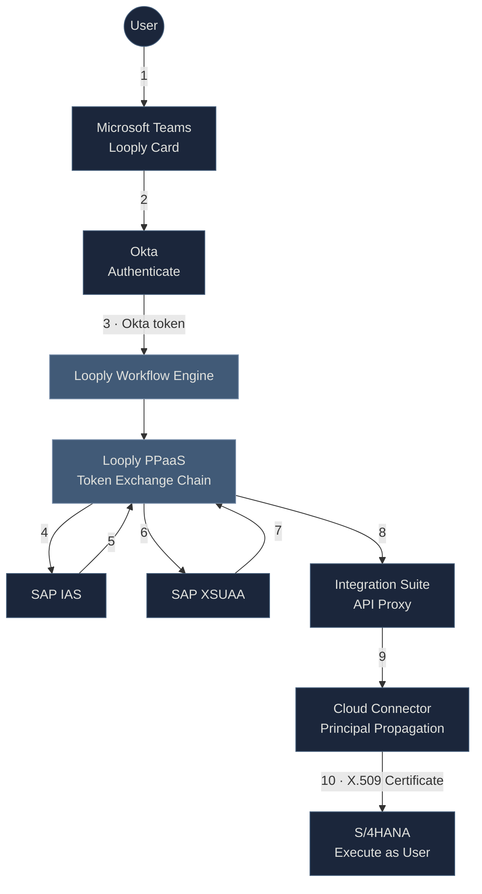

# SSO Setup Guide: Okta → SAP Integration

This guide walks you through configuring Okta Single Sign-On (SSO) for Looply workflows that connect to SAP systems. By the end of this setup, your users actioning workflows via Adaptive Cards in Microsoft Teams will authenticate once through Okta and seamlessly access SAP with their own identity preserved.

**How it works:** When a user clicks an action in Teams, they authenticate once through Okta. Looply's Token Exchange Chain then securely propagates their identity through SAP's cloud services, so the SAP backend sees the actual user (e.g., `john.smith@company.com`)—enabling proper authorization checks, audit logging, and user-specific data access.

**What this means for you:**

* Users log in once with their existing Okta credentials
* SAP sees the actual user making the request—not a technical account
* Full audit trail of who did what in SAP
* User-specific authorizations and data access are enforced
* No custom code required—just configuration

You configure the integration profiles once, and Looply orchestrates everything at runtime.



***

### Prerequisites

This setup spans multiple systems typically managed by different teams. Identify the relevant owners and coordinate access before starting.

<table><thead><tr><th>Component</th><th>Team (typical)</th><th width="264.06689453125">Access Required</th></tr></thead><tbody><tr><td><strong>Okta</strong></td><td>Identity / IAM</td><td>Admin access to create applications and authorization servers</td></tr><tr><td><strong>SAP IAS</strong></td><td>SAP Cloud Platform</td><td>Admin access to your Identity Authentication tenant</td></tr><tr><td><strong>SAP BTP</strong></td><td>SAP Cloud Platform</td><td>Subaccount admin with XSUAA entitlement</td></tr><tr><td><strong>Cloud Connector</strong></td><td>SAP Basis / Infrastructure</td><td>Admin access to configure mappings and certificates</td></tr><tr><td><strong>SAP On-Premise</strong></td><td>SAP Basis</td><td>Access to STRUST, RZ10, CERTRULE transactions</td></tr><tr><td><strong>User Directory</strong></td><td>Identity / SAP Basis</td><td>Ability to verify email addresses match across Okta and SAP</td></tr></tbody></table>

> 💡 Tip: Share the [SSO Configuration Checklist](sso-setup-guide-okta-sap-integration.md#sso-configuration-checklist) with each team so they can complete their sections independently.

### Part 1: Okta Setup Guide

#### Step 1.1: Create App Integration

1. Log into your **Okta Admin Console**
2. Navigate to **Applications** → **Applications**
3. Click **Create App Integration**
4. Select:
   * Sign-in method: **OIDC - OpenID Connect**
   * Application type: **Web Application**
5. Click **Next**

#### Step 1.2: Configure Application Settings

| Setting               | Value                                  |
| --------------------- | -------------------------------------- |
| App integration name  | `Looply SAP Integration`               |
| Grant type            | ☑️ Authorization Code ☑️ Refresh Token |
| Sign-in redirect URIs | `https://passport.looply.ai/custom`    |
| Controlled access     | Assign to appropriate users/groups     |

Click **Save**.

> ⚠️ **Important:** Enable **Refresh Token** grant type here. This allows the `offline_access` scope to work, enabling Looply to refresh tokens without requiring users to re-authenticate.

#### Step 1.3: Note Application Credentials

1. In the **General** tab of your new application, note:

| Value             | Location                                              |
| ----------------- | ----------------------------------------------------- |
| **Client ID**     | Client Credentials section                            |
| **Client Secret** | Client Credentials section (click eye icon to reveal) |

2. Note your **Okta domain**: `https://<your-org>.okta.com`

#### Step 1.4: Create Custom Authorization Server

You must create a custom authorization server with the audience set to match your Okta application's Client ID. Without this, IAS will reject the token.

1. Go to **Security** → **API** → **Authorization Servers**
2. Click **Add Authorization Server**
3. Configure:

| Setting     | Value                                                                                        |
| ----------- | -------------------------------------------------------------------------------------------- |
| Name        | `Looply SAP`                                                                                 |
| Audience    | <p><code>&#x3C;Your Okta Application Client ID from</code> </p><p><code>Step 1.3></code></p> |
| Description | Authorization server for Looply SAP integration                                              |

4. Click **Save**
5. Note the **Issuer URI** from the **Settings** tab—you'll need this for SAP IAS configuration

> ⚠️ **Critical:** The **Audience** must exactly match the **Client ID** of your Okta application created in Step 1.1. IAS validates this during token exchange and will reject tokens with mismatched audience claims.

#### Step 1.5: Configure Access Policy

> Skip this step, if corporate policy is already setup.&#x20;

The authorization server needs a policy to allow token issuance.

1. In your new authorization server, go to the **Access Policies** tab
2. Click **Add Policy**
3. Configure:

| Setting     | Value                                                       |
| ----------- | ----------------------------------------------------------- |
| Name        | `Looply Access Policy`                                      |
| Description | Allow Looply application access                             |
| Assign to   | **The following clients** → Select `Looply SAP Integration` |

4. Click **Create Policy**
5. Click **Add Rule** within the policy:

| Setting          | Value                                       |
| ---------------- | ------------------------------------------- |
| Rule Name        | `Allow Token Grants`                        |
| Grant type is    | ☑️ Authorization Code ☑️ Client Credentials |
| User is          | Any user assigned the app                   |
| Scopes requested | Any scopes                                  |

6. Click **Create Rule**

#### Step 1.6: Verify Scopes

1. Go to the **Scopes** tab in your Authorization Server
2. Ensure these scopes exist (they should be present by default):

| Scope            | Description              | Required |
| ---------------- | ------------------------ | -------- |
| `openid`         | OpenID Connect scope     | Yes      |
| `email`          | Access to email claim    | Yes      |
| `profile`        | Access to profile claims | Yes      |
| `offline_access` | Access refresh tokens    | Yes      |

#### Step 1.7: Assign Users to Application

1. Go back to **Applications** → **Applications**
2. Select your `Looply SAP Integration` application
3. Go to the **Assignments** tab
4. Click **Assign** and choose:
   * **Assign to People** for individual users
   * **Assign to Groups** for group-based access

***

#### Part 1: Configuration Summary

Gather this information for your Looply implementation team:

```yaml
okta:
  domain: https://<your-org>.okta.com
  authorization_server: Looply SAP  # your custom server name
  client_id: <from-step-1.3>
  client_secret: [provide securely]
  issuer: https://<your-org>.okta.com/oauth2/<auth-server-id>
  audience: <same-as-client_id>  # must match client_id
```

| Value                    | Where to Find It                                               |
| ------------------------ | -------------------------------------------------------------- |
| **Domain**               | Your Okta URL (e.g., `https://acme.okta.com`)                  |
| **Authorization Server** | Security → API → Authorization Servers → Your custom server    |
| **Client ID**            | Applications → Your App → General → Client Credentials         |
| **Client Secret**        | Applications → Your App → General → Client Credentials         |
| **Issuer**               | Security → API → Authorization Servers → Settings → Issuer URI |
| **Audience**             | Same as Client ID (configured in Step 1.4)                     |

### Part 2: SAP Identity Authentication Service (IAS) Setup

IAS acts as the bridge between your corporate identity provider (Okta) and SAP BTP services.

#### Step 2.1: Configure Okta as Corporate Identity Provider

> **Already configured?** If Okta is already set up as a Corporate Identity Provider in your IAS tenant, skip to Step 2.2. You can verify this in IAS Admin Console → Identity Providers → Corporate Identity Providers.

1. Log into your **IAS Admin Console**
2. Navigate to **Identity Providers** → **Corporate Identity Providers**
3. Click **Create** → Select **OpenID Connect**
4. Enter the following configuration:

| Field         | Value                                                                                  |
| ------------- | -------------------------------------------------------------------------------------- |
| Name          | `Okta`                                                                                 |
| Discovery URL | `https://<your-okta-domain>/oauth2/<auth-server-id>/.well-known/openid-configuration`  |
| Client ID     | _(Your Okta application's Client ID)_                                                  |
| Client Secret | _(Your Okta application's Client Secret)_                                              |

5. Under **Subject Name Identifier**, select **email**
6. Click **Save** and set to **Active**

#### Step 2.2: Create OIDC Application for Token Exchange

> **Already have an OIDC application?** If you have an existing IAS application configured for JWT Bearer grants, you can reuse it. Ensure it has Okta enabled under Trusted Identity Providers and note the Client ID/Secret for Looply.


When a custom IAS tenant is linked/trusted by a SAP BTP sub account, an OIDC application with the following ID: **XSUAA\_\<BTP sub account ID>** is automatically created by SAP BTP provisioning service.&#x20;


**Option A: Use the Auto-Created XSUAA Application**&#x20;

1. In IAS Admin Console, go to **Applications & Resources → Applications**
2. Find and select `XSUAA_<your-subaccount-id>`
3. Go to **Conditional Authentication**
4. Under **Default Authenticating Identity Provider**, select **Okta IDP (Corporate IDP)** from the dropdown
5. Click **Save**
6. Go to **Client Authentication**
7. Under **Secrets**, click **+Add** to create a client secret
8. Note the **Client ID** and **Client Secret** for Looply configuration
9. Click **Save**

> ⚠️ **Can't modify the Default Identity Provider?** If the auto-created application is managed by another team or you cannot change the default IdP, use Option B below.

**Option B: Create a Dedicated Looply Application**

Use this approach if you cannot modify the auto-created XSUAA application.

1. In IAS Admin Console, go to **Applications & Resources → Applications**
2. Click **Create** and configure:

| Setting      | Value                                              |
| ------------ | -------------------------------------------------- |
| Display Name | `looply_okta_ias`                                  |
| Home URL     | _(leave blank or enter your Looply workspace URL)_ |

3. After creation, go to **Parent Application**
4. Click **Edit** and select the `XSUAA_<btp subaccount-id>` application as the parent
5. Click **Save**
6. Go to **Conditional Authentication**
7. Under **Default Authenticating Identity Provider**, select **Okta**
8. Uncheck **Allow Identity Authentication Users Log On** (optional—ensures only Okta users can authenticate)
9. Click **Save**
10. Go to **Client Authentication**
11. Under **Secrets**, click **+Add** to create a client secret
12. API Access: Select **openid**
13. Note the **Client ID** and **Client Secret**
14. Click **Save**

**Required Application Settings Checklist**

Regardless of which option you choose, verify these settings:

| Setting                   | Location                        | Required Value                                |
| ------------------------- | ------------------------------- | --------------------------------------------- |
| Default Identity Provider | Conditional Authentication      | **Okta**                                      |
| Client Secret             | Client Authentication → Secrets | Generated and saved                           |
| Subject Name Identifier   | Subject Name Identifier         | **Email** (should inherit from Corporate IdP) |

#### Part 2: Configuration Summary&#x20;

After completing IAS setup, share these values with your Looply team:

```yaml
ias:
  tenant_url: https://<your-ias-tenant>.accounts.ondemand.com
  token_url: https://<your-ias-tenant>.accounts.ondemand.com/oauth2/token
  client_id: <from-client-authentication>
  client_secret: [provide securely]
```

***

### Part 3: SAP XSUAA Setup

XSUAA (Authorization and Trust Management Service) issues the final OAuth2 token that grants access to SAP APIs (including proxies exposed via SAP Integration suite).

#### Step 3.1: Trust IAS in Your BTP Subaccount

> **Already trusted?** If IAS is already configured as a trusted identity provider in your BTP subaccount, skip to Step 3.2. Check this in BTP Cockpit → Subaccount → Security → Trust Configuration.

1. Log into **SAP BTP Cockpit**
2. Navigate to your Subaccount → **Security** → **Trust Configuration**
3. Click **Establish Trust**
4. Select custom SAP IAS tenant and verify if the custom IAS tenant appears under Custom Identity Provider fro Applications

#### Step 3.2: Create XSUAA Service Instance

> **Already have an XSUAA instance?** If you have an existing XSUAA service instance with the `apiaccess` plan and `jwt-bearer` grant type enabled, you can reuse it. Skip to Step 3.3 to generate a new service key for Looply.


If you are unable to create **Authorization and Trust service instance (XSUAA)** without **apiaccess** plan, please check if **cloud foundry** is **enabled** in the BTP subaccount. Also verify if you have the relevant **entitlements** to the required plan assigned.


1. In BTP Cockpit, go to **Service Marketplace**
2. Search for **Authorization and Trust Management Service**
3. Click **Create** and configure:

| Setting       | Value                          |
| ------------- | ------------------------------ |
| Plan          | `apiaccess`                    |
| Instance Name | `looply-principal-propagation` |

#### Step 3.3: Create Service Key

1. After the instance is created, click **Create Service Key**
2. Name: `looply-key`
3. Copy the generated service key JSON

#### Part 3: Configurations summary&#x20;

Extract these values from your service key, share these values with your Looply team:

```yaml
xsuaa:
  token_url: <url from service key>/oauth/token
  client_id: <clientid from service key>
  client_secret: [provide securely]
```

***

### Part 4: Cloud Connector Configuration

Cloud Connector bridges SAP BTP and your on-premise SAP system, handling the principal propagation via X.509 certificates.

#### Step 4.1: Connect Cloud Connector to BTP Subaccount

1. Log into **Cloud Connector Administration** (typically `https://<host>:8443`)
2. In the left menu, click **Add Subaccount**
3. Enter your BTP subaccount details:

| Field           | Value                                               |
| --------------- | --------------------------------------------------- |
| Region          | Your BTP region (e.g., `cf.eu10.hana.ondemand.com`) |
| Subaccount      | Subaccount ID from BTP Cockpit → Overview           |
| Display Name    | Friendly name (e.g., `Production BTP`)              |
| Subaccount User | Your BTP user email                                 |
| Password        | Your BTP password                                   |

4. Click **Save**
5. Verify status shows **Connected** in BTP Cockpit → Connectivity → Cloud Connectors

#### Step 4.2: Configure Access Control

Define which SAP backend paths are accessible from BTP.

1. In Cloud Connector, select your subaccount
2. Go to **Cloud To On-Premise** → **Access Control** tab
3. Click **+** to add a backend system mapping:

| Step | Setting                | Value                                                   |
| ---- | ---------------------- | ------------------------------------------------------- |
| 1    | Back-end Type          | **ABAP System**                                         |
| 2    | Protocol               | **HTTPS**                                               |
| 3    | Internal Host          | Your SAP system hostname (e.g., `s4hana.internal.corp`) |
| 3    | Internal Port          | SAP HTTPS port (e.g., `44300`)                          |
| 4    | Virtual Host           | Virtual hostname for BTP (e.g., `s4hana-virtual`)       |
| 4    | Virtual Port           | Virtual port (e.g., `44300`)                            |
| 5    | Principal Type         | **X.509 Certificate (General Usage)**                   |
| 6    | Host In Request Header | **Use Virtual Host**                                    |

4. Click **Finish**
5. Add resource paths—select the mapping and click **+** in the Resources section:

| URL Path                 | Access Policy                                        |
| ------------------------ | ---------------------------------------------------- |
| `/sap/opu/odata/sap/`    | Path and All Sub-Paths                               |
| `/sap/opu/odata/LOOPLY/` | Path and All Sub-Paths _(if using custom namespace)_ |

> ⚠️ **Critical:** Principal Type must be **X.509 Certificate** for user identity propagation. Selecting "None" will prevent principal propagation.

#### Step 4.3: Generate Certificates

**System Certificate** (identifies Cloud Connector to SAP):

1. Go to **Configuration** → **On Premise** tab
2. In **System Certificate** section, click **Create** (self-signed) or **Import**
3. Set Common Name (e.g., `CloudConnector`) and validity period
4. Click **Create**
5. **Download** the certificate for SAP STRUST import

**CA Certificate** (signs short-lived user certificates):

1. In **CA Certificate** section, click **Create**
2. Configure similarly to system certificate
3. Click **Create**
4. **Download** the CA certificate for SAP STRUST import

#### Step 4.4: Configure Principal Propagation

1. In **Configuration** → **On Premise** → **Principal Propagation** section
2. Click **Edit** and configure:

| Field                      | Value         |
| -------------------------- | ------------- |
| Subject Pattern            | `CN=${email}` |
| Expiration Tolerance (h)   | `2`           |
| Certificate Validity (min) | `60`          |

3. Click **Save**
4. Click **Create Sample Certificate**—enter a test user's email
5. **Download** the sample certificate for SAP CERTRULE configuration

#### Step 4.5: Synchronize Trust with BTP

This syncs the trusted identity providers (XSUAA, IAS) from BTP to Cloud Connector.

1. Go to **Cloud To On-Premise** → select your subaccount
2. Click the **Principal Propagation** tab
3. Click the **Synchronize** button (🔄)
4. Verify the **Trust Configuration** table shows:

<table><thead><tr><th width="390.6796875">Name</th><th>Type</th><th>Trusted</th></tr></thead><tbody><tr><td><code>Subaccount=xxx, kid=default-jwt-key-xxx</code></td><td>IDP</td><td>✅</td></tr><tr><td><code>Subaccount=xxx, kid=PXK8_xxx</code></td><td>IDP</td><td>✅</td></tr></tbody></table>

5. Ensure both entries show **Trusted** = ✅ (green checkmark)

> ⚠️ **Re-sync required:** Whenever you update trust configuration in BTP (e.g., adding IAS), you must click Synchronize again.

#### Part 4: Configuration summary

Extract these values from cloud connector, share these values with your Looply team:

```yaml
cloud_connector:
  virtual_host: <virtual-host-from-access-control>
  virtual_port: <virtual-port>
  location_id: <if-configured>
  ca_common_name: <CN-from-CA-certificate>
  subject_pattern: "CN=${email}"
```

***

### Part 5: SAP On-Premise Configuration

These steps configure your SAP system to accept certificate-based authentication from Cloud Connector.

> **Already using Principal Propagation?** If your SAP system is already configured for certificate-based authentication with Cloud Connector (e.g., for other BTP integrations), you may only need to verify the existing configuration. Skip to [Step 4.4](sso-setup-guide-okta-sap-integration.md#step-4.5-verify-user-email-addresses) to ensure user emails are properly mapped.

#### Step 5.1: Import Cloud Connector CA Certificate (STRUST)

The Cloud Connector generates certificates for each user. SAP must trust this certificate authority.

1. Obtain the CA certificate from Cloud Connector:
   * Cloud Connector Admin → **Principal Propagation** → Export **Local CA Certificate**
2. In SAP, run transaction **STRUST**
3. Navigate to **SSL Server Standard** → **Certificate List**
4. Click **Import Certificate** and upload the Cloud Connector CA
5. Add to the certificate list and **Save**

#### Step 5.2: Import Cloud Connector System Certificate (STRUST)

* Obtain the System certificate from Cloud Connector:
  * Cloud Connector Admin → **Principal Propagation** → Export **System Certificate**
* In SAP, run transaction **STRUST**
* Navigate to **SSL Server Standard** → **Certificate List**
* Click **Import Certificate** and upload the Cloud Connector CA
* Add to the certificate list and **Save**

#### Step 5.3: Configure Certificate-Based Login (RZ10)

1. Run transaction **RZ10**
2. Edit your **instance profile**
3. Add these parameters:

```
icm/trusted_reverse_proxy_0 = "*CN=<Your-Cloud-Connector-CA-Name>*"
icm/HTTPS/verify_client = 1
login/certificate_mapping_rulebased = 1
```

4. Save and activate the profile
5. **Restart ICM** (transaction SMICM → Administration → ICM → Restart)

#### Step 5.4: Configure Certificate Mapping (CERTRULE)

This tells SAP how to map the certificate's CN (email) to a SAP user.

1. Run transaction **CERTRULE**
2. Import a sample certificate (from Cloud Connector for testing)
3. Create a new mapping rule:

| Setting         | Value                                 |
| --------------- | ------------------------------------- |
| Rule Attribute  | `Issuer`                              |
| Condition       | `*CN=<Your-Cloud-Connector-CA-Name>*` |
| Login Attribute | `Subject` → `CN`                      |
| Login Type      | `E-Mail (table USREMAIL)`             |

#### Step 5.5: Verify User Email Addresses

**This is critical.** For principal propagation to work, each SAP user must have an email address that **exactly matches** their Okta email.

1. Run transaction **SU01** to check individual users
2. Verify the **E-Mail** field (Address tab) matches the Okta email
3. For bulk verification, use **SE16** to query table **USREMAIL**

> **Note:** Email matching may be case-sensitive depending on your configuration. Ensure consistent casing between Okta and SAP.

***

### Configuration Summary

Once you've completed all steps, gather this information for your Looply implementation team:

| Component           | Information Needed                                                                       |
| ------------------- | ---------------------------------------------------------------------------------------- |
| **IAS**             | Tenant URL, Token URL, Client ID, Client Secret                                          |
| **XSUAA**           | Token URL, Client ID, Client Secret (from service key)                                   |
| **Cloud Connector** | Virtual Host, Virtual Port, Location ID (if configured), CA Common Name, Subject Pattern |
| **SAP Backend**     | System ID, Client number                                                                 |
| **User Mapping**    | Confirmation that user emails match between Okta and SAP                                 |

***

### Next Steps

After completing this setup:

1. Provide the configuration values to your Looply implementation team
2. We'll configure the Token Exchange Chain profiles in your Looply workspace
3. Test with a sample workflow to verify end-to-end connectivity
4. Roll out to your users

### SSO Configuration Checklist

Download this spreadsheet to track your setup and capture configuration values for your Looply implementation team.



#### What's Inside

| Worksheet                | Purpose                                                                                                             |
| ------------------------ | ------------------------------------------------------------------------------------------------------------------- |
| **Configuration Values** | Capture credentials, URLs, and settings from Okta, IAS, XSUAA, Cloud Connector, and SAP. Yellow cells = your input. |
| **Setup Checklist**      | Task-by-task checklist for every step. Mark complete (☐ → ✓), track status, note issues.                            |

***

_Need help? Contact your Looply implementation team or reach out to support@looply.ai_
