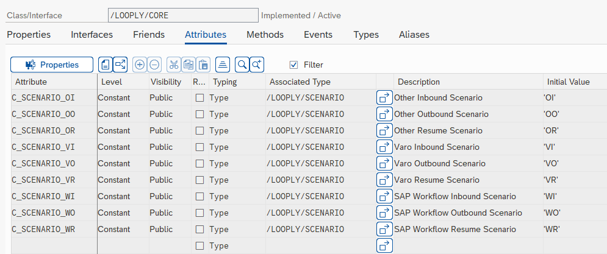

# Triggering or Resuming a Looply Workflow from SAP

## Triggering a Looply Workflow

You can trigger a Looply Workflow (your Workflow must start with an _Event Trigger_ step - see the [Triggering Workflows page](../../workflows/triggering-workflows.md) for more information) from SAP by calling the following method:&#x20;

**/LOOPLY/CORE=>TRIGGER\_WF**

The method has the following parameters:

<table><thead><tr><th width="248">Parameter Name</th><th width="101">Type<select><option value="7PeeNLqDkkwr" label="Import" color="blue"></option><option value="pPvjjLIx59Z2" label="Export" color="blue"></option></select></th><th width="135" data-type="checkbox">Mandatory</th><th>ABAP Type</th></tr></thead><tbody><tr><td>IM_LOOPLY_WF</td><td>Import</td><td>true</td><td>CHAR36</td></tr><tr><td>IM_LOOPLY_WF_VERSION</td><td>Import</td><td>false</td><td>INT1</td></tr><tr><td>IM_RECIPIENT</td><td>Import</td><td>false</td><td>CHAR241</td></tr><tr><td>IM_SCENARIO</td><td>Import</td><td>false</td><td>CHAR2</td></tr><tr><td>IM_SCENARIO_ID</td><td>Import</td><td>false</td><td>CHAR32</td></tr><tr><td>IM_SCENARIO_VERSION</td><td>Import</td><td>false</td><td>CHAR4</td></tr><tr><td>IM_STEP</td><td>Import</td><td>false</td><td>NUMC3</td></tr><tr><td>IM_PROCESS_ID</td><td>Import</td><td>false</td><td>CHAR48</td></tr><tr><td>IM_DATA</td><td>Import</td><td>false</td><td>STRING</td></tr><tr><td>IM_UTIL_DATA</td><td>Import</td><td>false</td><td>STRING</td></tr><tr><td>IM_TEST</td><td>Import</td><td>false</td><td>FLAG</td></tr><tr><td>IM_PROFILE</td><td>Import</td><td>false</td><td>CHAR30</td></tr><tr><td>EX_SUBRC</td><td>Export</td><td>false</td><td>SYSUBRC</td></tr><tr><td>EX_MESS</td><td>Export</td><td>false</td><td>BAPIRET2</td></tr><tr><td>EX_EXECUTION_ID</td><td>Export</td><td>false</td><td>CHAR36</td></tr></tbody></table>

**IM\_LOOPLY\_WF:** The ID of the Looply workflow you wish to trigger. To get the id you can click on the _Event Trigger_ step in your Looply workflow and copy the _Request URL_. It will be of the following form:

[https://api.looply.io/v2/workflows/triggerworkflow/\<looply workflow id>/\<looply workflow version>?test=true](https://api.looply.io/v2/workflows/triggerworkflow/ff3d4d38-b25f-463a-a26e-baec25644c9a/1?test=true)

**IM\_LOOPLY\_WF\_VERSION:** The version of the Looply workflow you wish to trigger. If you leave this blank when making the call from SAP, the latest version of the workflow will be triggered.

**IM\_RECIPIENT:** You can use this (optional) parameter to easily pass a recipient for a card to Looply. You can also leave this blank and pass recipients inside the data or util\_data strings.&#x20;

**IM\_SCENARIO:** This (optional) parameter can be used for logging purposes or it can be passed back to SAP when making a POST request from Looply to determine which function module to run (see the [Triggering SAP code from Looply](triggering-sap-code-from-looply.md) page for more information). The /LOOPLY/CORE class contains a number of constants for typical scenario values.

<figure><figcaption></figcaption></figure>

**IM\_SCENARIO\_ID**: Optional parameter which can be used for logging purposes or it can be passed back to SAP when making a POST request from Looply to determine which function module to run (see the [Triggering SAP code from Looply](triggering-sap-code-from-looply.md) page for more information). Typical values include your Varo form type or SAP workflow id.

**IM\_SCENARIO\_VERSION:** Optional parameter which can be used for logging purposes or it can be passed back to SAP when making a POST request from Looply to determine which function module to run (see the [Triggering SAP code from Looply](triggering-sap-code-from-looply.md) page for more information). Typical values include your Varo form version or SAP workflow version.

**IM\_STEP:** If you want to trigger multiple Looply workflows for the same scenario (the same Varo form type or SAP workflow for example) you can use this (optional) parameter to distinguish between them.

**IM\_PROCESS\_ID:** The process id of your Looply workflow. If you do not pass one in, Looply will assign one automatically. You need the process id if you wish to [resume a workflow](triggering-or-resuming-a-looply-workflow-from-sap.md#resuming-a-looply-workflow). Looply does not allow multiple "In progress" instances with the same process id (although you can trigger a workflow instance with the process id of a previous workflow instance which has completed) so the parameter must have a unique value. Typical values include your Varo form id  or PO number. (Tip: include your system id in the process id to avoid clashes when workflows are triggered from different systems in your landscape).

**IM\_DATA:** Data you wish to pass to your Looply worklow. This will typically be in JSON format. (Tip: you can convert your ABAP internal table or structure to a JSON string by use of method  /ui2/cl\_json=>serialize).

**IM\_UTIL\_DATA:** Second data string you may pass to the workflow.

**IM\_TEST:** If you set this flag, a test request will be made to Looply. The data will become available in the _Workflow Studio_ for binding, but the workflow will not actually be triggered.&#x20;

**IM\_PROFILE:** (available from version 110) Used to set an environment profile (see [Environment Variables & Profiles](https://academy.looply.ai/workflows/environment-variables-and-profiles) ) when triggering a workflow. If the import parameter is left blank, the code will check the "System Settings" configuration for a profile.

**EX\_SUBRC:** Return subrc code indicating whether the call to Looply worked or not.

**EX\_MESS:** Bapiret2 parameter containing success or error message.

**EX\_EXECUTION\_ID:** Id retrieved from Looply for logging purposes.

## Resuming a Looply Workflow&#x20;

Looply Workflows which are at an "Awaiting Response" status can be resumed from SAP by calling the following method:&#x20;

**/LOOPLY/CORE=>RESUME\_WF**

The method has the following parameters:

<table><thead><tr><th width="248">Parameter Name</th><th width="101">Type<select><option value="7PeeNLqDkkwr" label="Import" color="blue"></option><option value="pPvjjLIx59Z2" label="Export" color="blue"></option></select></th><th width="135" data-type="checkbox">Mandatory</th><th>ABAP Type</th></tr></thead><tbody><tr><td>IM_PROCESS_ID</td><td>Import</td><td>true</td><td>CHAR48</td></tr><tr><td>IM_DATA</td><td>Import</td><td>false</td><td>STRING</td></tr><tr><td>IM_UTIL_DATA</td><td>Import</td><td>false</td><td>STRING</td></tr><tr><td>IM_MESS</td><td>Import</td><td>false</td><td>STRING</td></tr><tr><td>IM_ACTION</td><td>Import</td><td>false</td><td>STRING</td></tr><tr><td>IM_SCENARIO</td><td>Import</td><td>false</td><td>CHAR2</td></tr><tr><td>IM_SCENARIO_ID</td><td>Import</td><td>false</td><td>CHAR32</td></tr><tr><td>IM_SCENARIO_VERSION</td><td>Import</td><td>false</td><td>CHAR4</td></tr><tr><td>IM_STEP</td><td>Import</td><td>false</td><td>NUMC3</td></tr><tr><td>IM_RETRY</td><td>Import</td><td>false</td><td>FLAG</td></tr><tr><td>EX_SUBRC</td><td>Export</td><td>false</td><td>SYSUBRC</td></tr><tr><td>EX_MESS</td><td>Export</td><td>false</td><td>BAPIRET2</td></tr><tr><td>EX_INTERNAL_CODE</td><td>Export</td><td>false</td><td>STRING</td></tr><tr><td>EX_HTTP_STATUS</td><td>Export</td><td>false</td><td>INT</td></tr></tbody></table>

**IM\_PROCESS\_ID:** The process id of the workflow you wish to resume.

**IM\_DATA:** Data you wish to pass to your Looply worklow. This will typically be in JSON format. (Tip: you can convert your ABAP internal table or structure to a JSON string by use of method  /ui2/cl\_json=>serialize).

**IM\_UTIL\_DATA:** Second data string you may pass to the workflow.

**IM\_MESS:** Often we may want to send a message to the end user when a workflow is resumed. This can easily be accomplished by using this parameter (of course messages can also be included in the IM\_DATA or IM\_UTIL\_DATA strings).&#x20;

**IM\_ACTION:** Workflows can be resumed in a number of ways for different reasons. We might for example want to resume a workflow when a request is approved, rejected, deleted etc. This parameter can provide an easy way to distinguish between the different "resume scenarios".

**IM\_SCENARIO:** Optional parameter used by the method for logging purposes. (see screenshot above for typical values)

**IM\_SCENARIO\_ID**: Optional parameter which can be used for logging purposes. Typical values  include your Varo form type or SAP workflow id.

**IM\_SCENARIO\_VERSION**: Optional parameter used by the method for logging purposes. Typical values include your Varo form version or SAP workflow version.

**IM\_STEP:** If you want to trigger multiple Looply workflows for the same scenario (the same Varo form type or SAP workflow) you can use this (optional) parameter to distinguish between them.

**IM\_RETRY:** (available from version 110) If this is flag is set and the resume fails because the workflow is not at a wait state, the resume will be attempted again (up to a maximum of 10 times) after a 1 second interval.

**EX\_SUBRC:** Return subrc code indicating whether the call to Looply worked or not.

**EX\_MESS:** Bapiret2 parameter containing success or error message.

**EX\_INTERNAL\_CODE:** (available from version 110) Internal code passed back from API call indicating a succes or reason for failure. See [the API documentation](https://academy.looply.ai/api-reference/workflow-api#resumeworkflow) for possible values.

**EX\_HTTP\_STATUS:** (available from version 110) Internal code passed back from API call indicating the status of the HTTP request. See [the API documentation](https://academy.looply.ai/api-reference/workflow-api#resumeworkflow) for possible values.

## Process Determination Configuration

Instead of passing hard-coded values into the above  parameters, it is good practise to maintain and read the _Looply Process Determination table  (/LOOPLY/ACTIVITY)_. This will also help the system to keep more accurate logs of your Looply activity. The table can be maintained via the following IMG transaction: \
SPRO->General Application Functions->Looply->Process Determination. \
Here, based on your _Scenario, Scenario Id, Scenario Version_ and _Step_ values you can determine which Looply workflow to trigger (or which SAP function module to call in an _Inbound_ or _Workflow Outbound Scenario_)&#x20;
