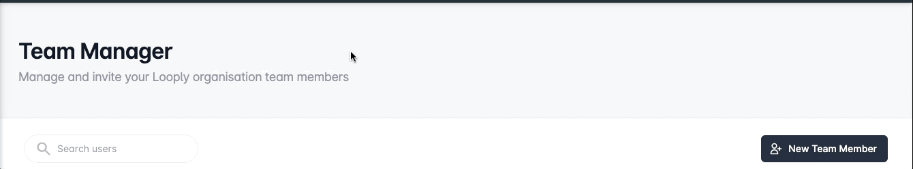
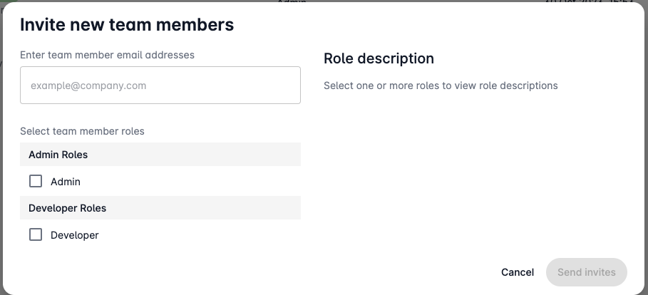

# Managing Organisations

Explore the power of collaborative efficiency within Looply's **Team Manager**, designed for organisational leaders.&#x20;

Admin users can seamlessly oversee and manage their organisation's team members, shaping collaboration dynamics. From extending invitations to controlling access levels through user roles, the Team Manager is your hub for organisational synergy. Dive into a workspace where integrations, workflows, apps, and adaptive card templates are shared seamlessly, fostering a united and productive team.


**Note:** The Looply Team Manager is only available to organisation admins.&#x20;


## Inviting New Team Members

Looply's Team Manager allows admin users to invite new team members to join their organisation and facilitate collaboration.&#x20;

To invite a new team member, click the **New Team Member** button located on the Team Manager page.&#x20;

<figure><figcaption></figcaption></figure>

### Create Invite

To invite users to join your Looply organisation, you simply need to provide their **email address** and specify a **role** for that user.&#x20;

<figure><figcaption></figcaption></figure>

See [team-roles-and-permissions.md](team-roles-and-permissions.md "mention") for more information about roles within Looply.&#x20;

Once you have entered at least one email address and role, you can send your invites by clicking the **Send invites** button.&#x20;

### Revoke Invite

You can revoke the invitation of a user at any time before it has been accepted by clicking on the overflow menu next to the invited user and selecting the **Revoke Invite** option.&#x20;

This user's invitation will be immediately revoked and they will not be able to use it to join your organisation.&#x20;

### Resend Invite

Need to issue a new invitation link to your team member?&#x20;

Simply click the overflow menu next to the user within the Team Manager and select the **Resend Invite** option.&#x20;

## Managing Team Members

In our Looply Team Manager, organisation admins gain a comprehensive overview of their team's dynamics.&#x20;

This feature-rich space enables admins to track invitation statuses, view assigned roles, monitor authentication levels, and access last login dates for each team member.&#x20;

Empowered with these insights, admins can seamlessly adjust roles, ensuring optimal collaboration. Furthermore, the ability to disable user accounts adds an extra layer of control, offering a streamlined approach to organisational governance.

### Update Roles

Effortlessly tailor your team's dynamics with Looply's role adjustment feature.&#x20;

View and amend roles for any non-admin team members by accessing the **Edit Roles** option within the user overflow menu.&#x20;

The intuitive **Edit Team Member** dialog presents a straightforward interface for role adjustments. Admins can seamlessly save their changes with a click of the **Confirm** button, ensuring the team's structure aligns precisely with organisational needs.

### Access Control

Admins can seamlessly disable access for any non-admin team member, immediately restricting login and application usage.&#x20;

A team member's account can be disabled by accessing the overflow menu and clicking the **Disable** option.&#x20;

To reinstate access, a simple selection of the **Restore** option re-enables team member accounts, offering a flexible approach to team management.
