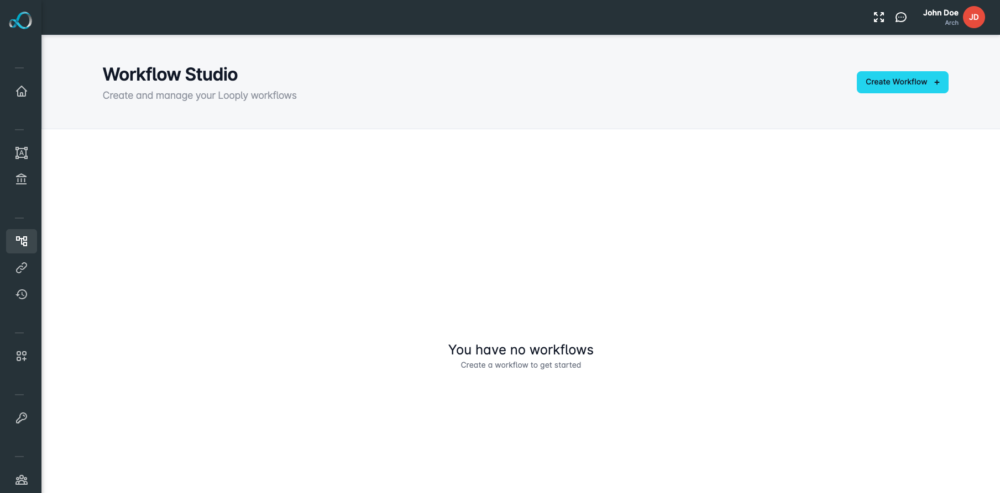
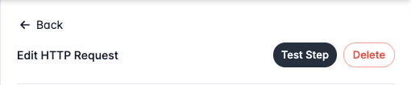
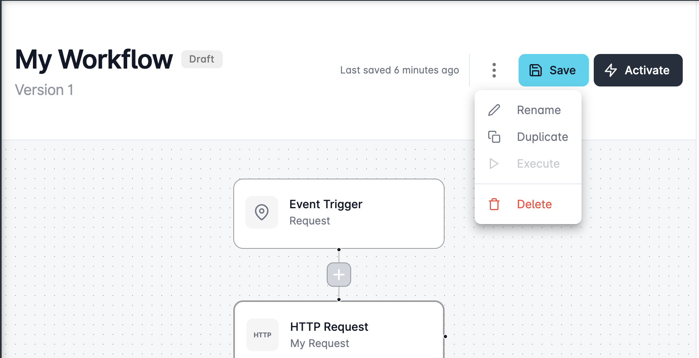

# Building Workflows

## Introduction

At the heart of Looply lies the transformative potential of workflow automation, a tool designed to streamline operations, reduce manual tasks, and enhance productivity across your organisation.&#x20;

Unlock this potential with Looply Academy, providing you with the knowledge and tools needed to construct efficient, automated processes tailored to your unique business needs.

## Use Cases

Here are some common use cases you can automate with Looply Workflows:

Automated Employee Onboarding

Once a new employee’s data is entered into the HR system, Looply can orchestrate a sequence of tasks — from sending welcome emails, populating them in relevant project management tools, to initiating IT provisioning requests.

Sales Report Consolidating

For sales teams using multiple platforms to track leads, Looply can amalgamate data from all these sources at the end of the week, process this information, and present consolidated reports in a Teams channel.

Expense Validator

Whenever an expense entry is made in platforms like Expensify or Concur, Looply can validate this against set criteria and then either automatically approve standard expenses or route exceptions to managers via Teams.

Inventory Alert System

In retail, if stock levels in the inventory system fall below a certain threshold, Looply can generate alerts, send purchase order requests to suppliers, and notify the procurement team in Teams.

Customer Feedback Loop

After a customer service interaction, Looply can dispatch a feedback survey. Based on the feedback, either a thank-you message can be automated for positive responses, or in the case of negative feedback, an escalation notice is sent to the customer service head.

Procurement Auto-Fill

A bot that peruses incoming emails for invoices, extracts details, populates them in a procurement platform and then notifies the finance team for validation.

Attendance Bot

Merging attendance data from biometric systems with HRMS platforms, so if an employee misses a punch-in, they receive a prompt on MS Teams.

Feedback Aggregator

After training sessions, Looply can aggregate feedback from Google Forms, categorize comments, and present concise summaries in MS Teams channels.

## Creating Workflows

You can get started creating a new workflow by navigating to the **Workflow Studio** and clicking the **Create** button.&#x20;

Enter an appropriate name for your workflow in the dialog and click **Create** to continue to the Workflow Builder.&#x20;

<figure><figcaption></figcaption></figure>

### Using the Workflow Builder

#### Configuring Event Trigger

The first step you'll need to carry out is to configure how your workflow should be executed.&#x20;

Looply currently supports 2 workflow triggers:&#x20;

* HTTP Requests
* Schedules

<figure><figcaption></figcaption></figure>

See [triggering-workflows.md](triggering-workflows.md "mention") for more information on workflow triggers.&#x20;

#### Adding Steps

After setting up your event trigger, you're ready to start adding steps and building out your workflow.&#x20;

To add a new step to your workflow, click the **+** button located under any step and select the new step you would like to add from the right panel **Toolbox**.&#x20;

<figure><figcaption></figcaption></figure>

#### Deleting Steps

You can delete steps in your workflow by simply clicking on any step you wish to delete, and then clicking the **Delete** button located in the right side panel.&#x20;

### Saving Changes

You can save changes to your workflow at any time by clicking the **Save** button located at the top of the page.&#x20;


**Note:** If you attempt to save changes on a workflow that has been activated, a new version will automatically be created for you to prevent breaking any processes using the previous live version.&#x20;


## Testing Workflows

Steps within your workflow that are expected to return a response, such as HTTP Requests, Functions and Conditionals, can be tested individually to ensure they are working correctly and provide wider access to the exact response data.&#x20;

When you execute a test of an individual step within your workflow, the response is stored and can be accessed by any subsequent steps to allow support for data passing.&#x20;

#### Testing Steps

You can perform a test of a specific step in your workflow by selecting the step from the canvas and clicking the **Test Step** button located in the right-side panel header.&#x20;

We will attempt to execute your step with the current step data and display the response.&#x20;

<figure><figcaption></figcaption></figure>

#### Executing Workflows

You can test your entire workflow from start to finish by executing it from within the Workflow Builder.&#x20;

To execute your workflow, make sure you have saved your most recent changes and then select the overflow menu button, and choose the **Execute** option.&#x20;

For workflows triggered by an HTTP Request, if you have configured your payload data then this will be automatically passed in and used as mock data for the test execution.&#x20;

<figure><figcaption></figcaption></figure>

## Activating Workflows

Once you have finalised your workflow, you can activate your workflow by clicking the **Activate** button located at the top of the page.&#x20;

Activating a workflow will prevent any further changes from being made to the current version - and force changes to be pushed onto a new version to protect any production systems using it.&#x20;
