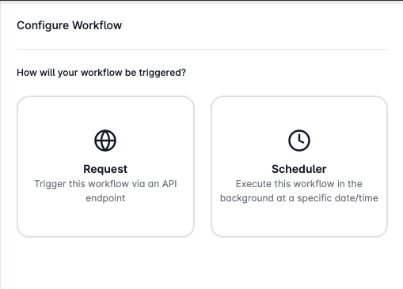
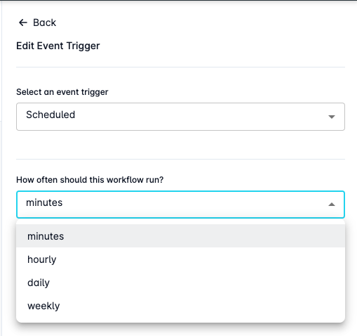

# Triggering Workflows

Every workflow within Looply is required to have a defined event trigger as the first step to determine how the process will be initiated. Here are some triggers we currently support:&#x20;

* **HTTP** **Request** - triggers your workflow when an HTTP request is received from your system or client
* **Scheduled** - triggers your workflow on a preset schedule defined by you

<figure><figcaption></figcaption></figure>

## Trigger via HTTP Request

Request event triggers can be used when you want to be able to trigger an execution of your workflow by sending an **HTTP Request** to the Looply API. These event triggers also support attaching a body payload to your request which will be passed into your workflow at runtime.&#x20;

### Configure Payload

Workflows set up to use an HTTP Request as the trigger also supports the configuration of a mock payload during workflow development.&#x20;

Mock payloads work by allowing the developer to send a POST request to a unique Looply API with data in the body that will resemble real-world data your workflow is expected to receive during runtime. This mock data is then stored against your workflow and can be accessed by steps within your workflow or will be attached during test executions.&#x20;

#### Send Request

You can find the unique Looply API endpoint for receiving data for your workflow by clicking on your event trigger step and opening it in the side panel.&#x20;

You will find your unique endpoint under the **Request URL** field and can copy this to clipboard with the **Copy** button.&#x20;

Now all you need to do is use a REST client of your choice to send a POST request to this endpoint and setup your mock data in the body.&#x20;

#### Detecting Payload

Once you have sent at least 1 test request to your unique endpoint, you can sync the data to your workflow by clicking on the **Detect Payload** button.&#x20;

Your mock payload will be displayed within this side panel for you to confirm.&#x20;

<figure><figcaption></figcaption></figure>

## Scheduling Workflows

Scheduled workflows allow you to run automated workflows at fixed intervals without manual intervention. These are ideal for tasks like data cleanups, reporting, syncing external systems, or sending reminders on a recurring basis.

Because scheduled workflows are executed automatically, they **do not support a dynamic payload at runtime**. Instead, they rely on static configurations - making environment profiles particularly useful.

<figure><figcaption></figcaption></figure>

### Supported Scheduling Options

You can configure a scheduled workflow to run at any of the following intervals:

* **Minutes**
* **Hourly**
* **Daily**
* **Weekly**

### Using Execution Profiles with Scheduled Workflows

When setting up a schedule, you can now **specify an environment variable profile** to be used at runtime. This allows you to inject static, environment-specific data into your workflow payload - ensuring it behaves correctly across different environments (e.g. `dev`, `qa`, or `prod`).

If no profile is specified, the **default profile** (if set) will be used automatically.

#### Automatic Start on Activation

Once a schedule is configured and your workflow is **activated**, it will begin executing according to the schedule immediately - using the selected execution profile for each run.

### Pause/Resume Schedules

Once activated, scheduled workflows can be paused at any given time by visiting the Workflow Builder, selecting the Event Trigger step, and then clicking the **Pause** button.&#x20;

Paused workflows can be resumed at any time by repeating the same process as above and clicking the **Resume** button.&#x20;


**Note:** You can only have one version of your scheduled workflow active at any given time. If you create a new version of your scheduled workflow and activate it - the previous version schedule will be canceled.&#x20;

