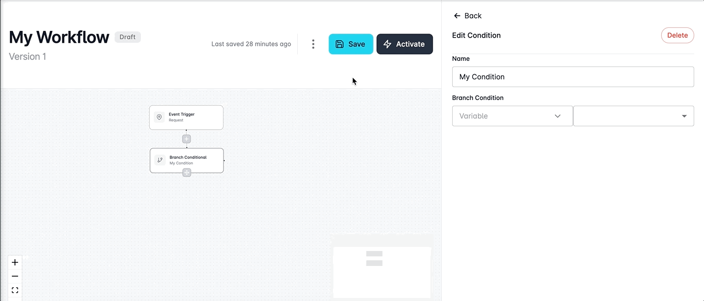
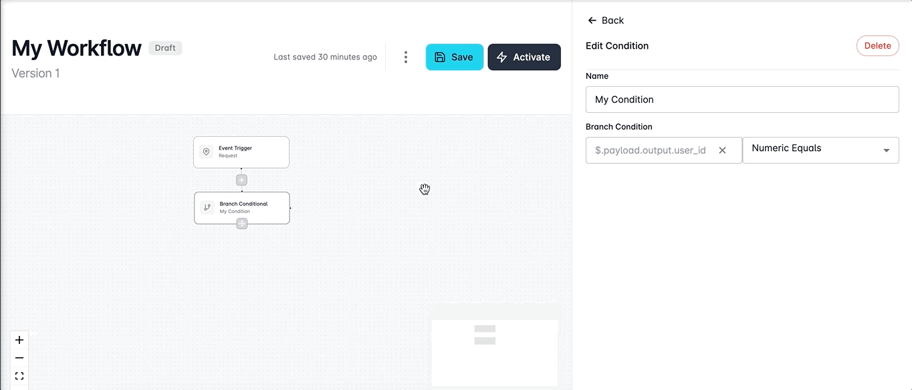

# Using Branch Conditionals

Branch conditionals empower users to set a single variable and conditional operator rule, and then create multiple branches of outcomes tailored to the values evaluated against the specified condition.&#x20;

With the ability to define diverse paths based on varying values or outcomes, these Branch Conditional Steps elevate the sophistication of your workflows, providing a nuanced approach to shaping the flow of your processes.

## Define Conditional Logic

You can get started adding your conditional logic by clicking on a **+** button in your workflow and selecting the **Branch** **Conditional** step from the Workflow's toolbox.  &#x20;

<figure><figcaption></figcaption></figure>

### Add Condition

Branch Conditionals work differently from standard Conditionals, in that they only support one single condition being defined but can have multiple different value outcomes.&#x20;

You can define your single conditional rule by entering a variable in the text field and selecting a conditional operator from the dropdown menu.&#x20;

Conditions we support are:&#x20;

* Boolean Equals
* Is Boolean
* Is Null
* Is Numeric
* Is Present
* Is String
* Is Timestamp
* Not
* Numeric Equals
* Numeric Greater Than
* Numeric Greater Than Equals
* Numeric Less Than
* Numeric Less Than Equals
* String Equals
* String Greater Than
* String Greater Than Equals
* String Less Than
* String Less Than Equals
* String Matches
* Timestamp Equals
* Timestamp Greater Than
* Timestamp Greater Than Equals
* Timestamp Less Than
* Timestamp Less Than Equals

<figure><figcaption></figcaption></figure>

### Creating Value Branches

Once you have defined your conditional rule, click and drag from the icon attached to the Branch Conditional step within the workflow to create a new value branch.&#x20;

The Create Branch dialog will open and allow you to specify a:&#x20;

* Label - the user-friendly name for your outcome
* Value - the value that will be evaluated against the condition
* Type - the type of outcome being handled (`Default`, `Positive`, `Negative`, `Warning` or `Info`)

Enter these values for your branch and click **Create**.&#x20;

You can create as many branches as required for your condition to handle different outcomes.&#x20;

<figure><figcaption></figcaption></figure>

#### Deleting Branches

Branches can be edited by simply clicking on the branch and editing its values in the sidebar window or removed by clicking the **Delete** button.&#x20;

<figure><figcaption></figcaption></figure>
