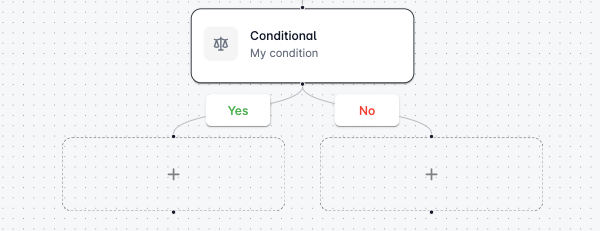
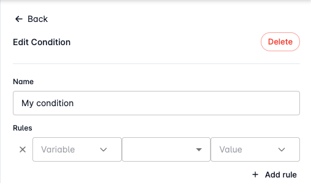
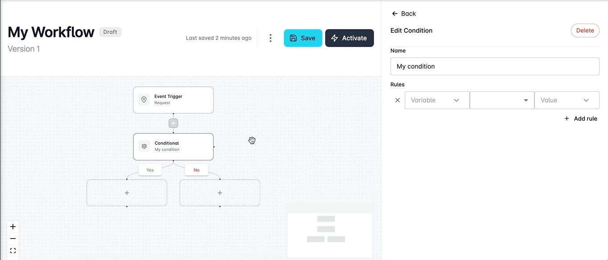

# Using Conditionals

Dictate the flow of your processes with precision using Looply's conditional steps.&#x20;

Conditionals operate in an if-else fashion, allowing users to define a series of conditions to evaluate and then seamlessly branch workflows into two distinct paths based on true or false outcomes.&#x20;

Whether crafting your own static conditions or evaluating data returned from a prior workflow step, these conditional steps offer unparalleled control and flexibility in shaping the logic of your workflows.

## Define Conditional Logic

You can get started adding your conditional logic by clicking on a **+** button in your workflow and selecting the **Conditional** step from the Workflow's toolbox.  &#x20;

This will add the conditional step to your workflow and branch out into 2 separate flows for **Yes** and **No** outcomes. Each new branch will contain a placeholder until you are ready to determine your next steps.&#x20;

<figure><figcaption></figcaption></figure>

### Adding Rules

You can use the **Rules** section of the Conditional editor to define the specific conditions to evaluate as true for your condition to pass.&#x20;

<figure><figcaption></figcaption></figure>

Each rule contains a **variable name**, a **condition**, and a **value**.&#x20;

Conditions we support are:&#x20;

* Boolean Equals
* Is Boolean
* Is Null
* Is Numeric
* Is Present
* Is String
* Is Timestamp
* Not
* Numeric Equals
* Numeric Greater Than
* Numeric Greater Than Equals
* Numeric Less Than
* Numeric Less Than Equals
* String Equals
* String Greater Than
* String Greater Than Equals
* String Less Than
* String Less Than Equals
* String Matches
* Timestamp Equals
* Timestamp Greater Than
* Timestamp Greater Than Equals
* Timestamp Less Than
* Timestamp Less Than Equals

Create your rule by manually entering or selecting the variable that should be evaluated, followed by the conditional operator, and finally manually entering or selecting the expected value.&#x20;

You can add more than one rule by clicking the **+ Add rule** button and repeating this process.&#x20;

Additionally, you can access the dropdown menu in the Variable and Value fields to select data from previous steps in your workflow for use in your rule.&#x20;


**Note:** Remember when adding rules, **all of your rules** must be true for your conditional logic to pass and follow down the **Yes** branch of your workflow.&#x20;


## Handling Outcomes

Once you have added all of your conditional logic, the final step is to handle what your workflow should do next depending on the outcome of your condition. &#x20;

Conditional steps are designed to branch out into two flows for Yes (true) and No (false) outcomes of your logic. Each branch is initialized with a placeholder step.  &#x20;

You can determine the next steps for your workflow by clicking on the placeholder step, and then selecting the new step you want to insert in its place for each outcome.&#x20;


**Note:** Deleting conditional steps within your workflow will result in both outcome branches and all subsequent steps also being deleted.&#x20;


<figure><figcaption></figcaption></figure>
