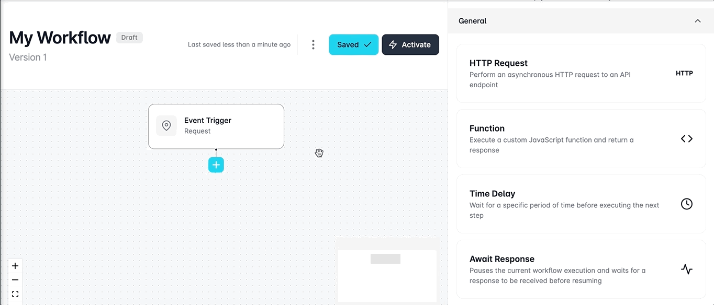
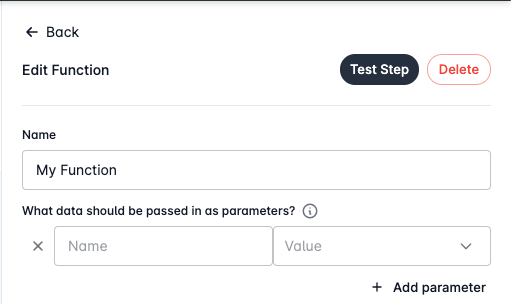

# Using Functions

Unlock the potential of custom functionality in your workflows with Looply's powerful function steps. Tailor your processes by creating functions, defining parameters, and writing custom JavaScript code. Seamlessly integrate your logic and tap into pre-defined libraries, empowering you to elevate your application experience.&#x20;

Whether you need to automate complex tasks, manipulate data, or integrate with external services, these custom function steps offer unparalleled flexibility to meet your unique workflow requirements.

## Configuring Functions

You can get started configuring your function by clicking on a **+** button in your workflow and selecting the **Function** step from the Workflow's toolbox.  &#x20;

<figure><figcaption></figcaption></figure>

### Passing Parameters

Looply empowers you to effortlessly pass custom data parameters to your function code, providing a seamless way to fine-tune and optimize the operation of your custom functions.

Configure your parameters by adding a name and value for each parameter, tailoring the data to your specific needs. Need more parameters? No problem. Click the **+** **Add parameter** button to add more.

Users can decide to manually enter static values for each parameter, or use the dropdown menu to select a value from a previous step in your workflow.&#x20;

<figure><figcaption></figcaption></figure>

### Writing JavaScript Code

Use the integrated Monaco code editor to write your custom JavaScript inside the `myFunction()` code block. **Data returned from here will be returned for further use within your workflow.**&#x20;

The `myFunction` code block is designed to accept a `params` object, which will contain all of your previously configured parameter data. You can use this object to access your parameter data by referencing `params.your_parameter` in your code.&#x20;

For example, if you configured a parameter with the name `id` then it's value could be accessed within `myFunction` by referencing `params.id`.&#x20;

### Using Libraries

Similarly to parameters, our workflow functions also support access to a range of useful JavaScript libraries to assist you.&#x20;

The `myFunction` code block has access to a second parameter called `libraries`.&#x20;

You can access any of our JavaScript libraries through this object by referencing `libraries.library_name`.&#x20;

Here is an example of how you could use the UUID JavaScript library within your function:&#x20;




```javascript
function myFunction(params, libraries) {
    const uuid = libaries.uuid; 
    const id = uuid.v4(); 
    return id; 
}
```




## Testing Functions

Functions can be effortlessly validated by configuring your function and using the Test Step feature.&#x20;

Simply click the **Test Step** button in the header of the Function editor, execute your code, and receive instant feedback.&#x20;

Any returned output will be displayed, ensuring a seamless testing experience within the confines of your workflow.
