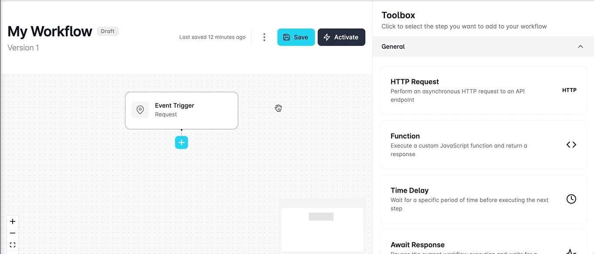
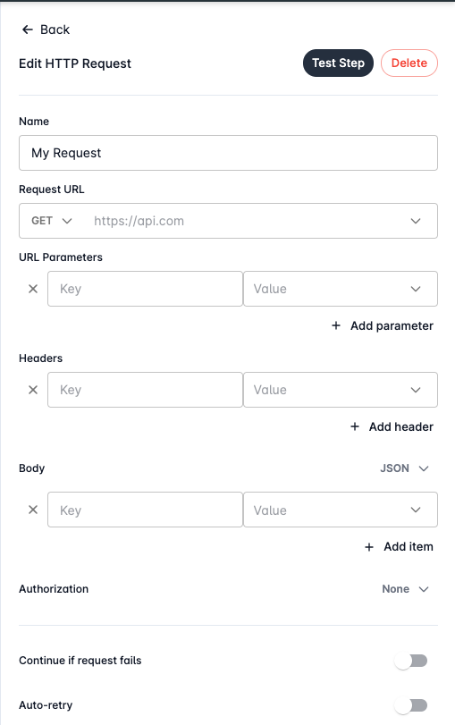
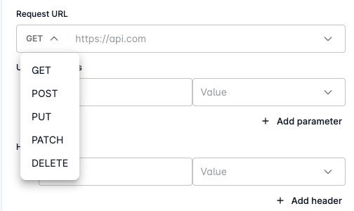
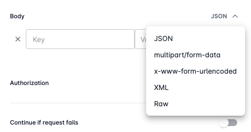
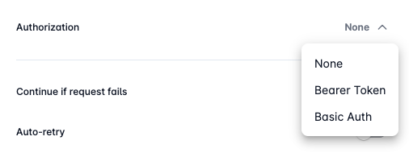

# Using HTTP Requests

## Configuring Requests

You can get started configuring your request by clicking on a **+** button in your workflow and selecting the **HTTP Request** step from the Workflow's toolbox.  &#x20;

<figure><figcaption></figcaption></figure>

Requests sent from Looply support the following configuration options:&#x20;

* Request URL
* Request Type
  * `GET`
  * `POST`
  * `PUT`
  * `PATCH`
  * `DELETE`
* URL Parameters
* Headers
* Body Type
  * `JSON`
  * `multipart/form-data`
  * `x-www-form-urlencoded`
  * `XML`
  * `Raw`
* Body
* Authorization
  * `Bearer Token`
  * `Basic Auth`

<figure><figcaption></figcaption></figure>

### Request

To send an HTTP request, start by selecting the desired **request type** from the dropdown menu. Choose from `GET`, `POST`, `PUT`, `PATCH`, or `DELETE`. Then, in the **Request URL** text field, enter the accurate destination URL to which you want to send the request. Make sure the URL is correctly formatted to ensure successful communication.

<figure><figcaption></figcaption></figure>

#### URL Parameters

Users are also able to add query string parameters in their request if they require them under the **URL Parameters** section.&#x20;

Add specific query string parameters by entering their names and values in the corresponding **Key** and **Value** inputs. Need more parameters? Simply click **+** **Add parameter** for additional sets of inputs. This flexibility empowers you to tailor your request to meet specific criteria.

#### Headers

Additionally, users can specify specific headers they wish to attach to their request under the **Headers** section.&#x20;

Add headers by entering their names and values in the corresponding **Key** and **Value** inputs. Click the **+** **Add header** button for inserting more than one header.&#x20;

### Payload

The **Body** section allows you to define the payload of your HTTP request. Select the appropriate 'Body Type' from the dropdown menu - `JSON`, `multipart/form-data`, `x-www-urlencoded`, `XML`, or `Raw`.&#x20;

<figure><figcaption></figcaption></figure>

For `JSON`, `multipart/form-data`, and `x-www-urlencoded`, use the **key-value pair inputs** to finely tune your payload - using the **+ Add item** button to insert more than one data item.&#x20;

Alternatively, for `XML` or `Raw` data, leverage the **text area** to input your content directly.&#x20;

### Authorization

HTTP requests executed by Looply can be authorised through the use of **Bearer Tokens**, **Basic Auth** (username and password) and Looply **Integration** credentials.&#x20;

<figure><figcaption></figcaption></figure>

#### Bearer Tokens

To attach a bearer token to your HTTP Request, select the `Bearer Token` option in the dropdown menu under the **Authorization** section.&#x20;

A single text field will be displayed below for you to enter your bearer token string.&#x20;

#### Basic Auth

To use basic username and password authentication with your HTTP Requests, select the `Basic Auth` option from the dropdown menu.&#x20;

Enter a username and password to be used in the relevant text fields.&#x20;

#### Integration

HTTP Requests can be authenticated with the authentication credentials of an existing connected or configured integration within Looply. For example, this could be through the bearer token retrieved from an integration made by your organisation admin, client credentials or API keys.&#x20;

To use integration authentication, select the Integration option from the dropdown menu.&#x20;

Access the integration selection dropdown menu to view all existing connected or configured integrations with a supported authentication method for your request, and select the integration to attach it.&#x20;


**Tip:** You can also select an integration to use for authenticating the request by binding the selection field to the id of either the integration or profile - which is visible on the configure integration profile page. Simply, select the `Use a variable` option when selecting an integration and bind it to your data in your workflow. This allows the conditional selection of an integration based on your workflow data and the integration is automatically picked up at runtime.                          &#x20;


### Failure Scenarios

Navigate through potential hiccups effortlessly - Looply equips you with options to gracefully handle failures in your HTTP Requests, offering the ability to continue on failure and automatic retry functionalities.

<figure><figcaption></figcaption></figure>

#### Continue on Failure

Looply supports the ability to continue executing your workflow in the event the HTTP Request step fails. This can be useful if you wish to manually handle any errors or if your workflow is not reliant on the response from the request.&#x20;

This functionality can be enabled by toggling the **Continue if request fails** switch within the HTTP Request editor.&#x20;

#### Automatic Retry

Additionally, users can enable automatic retries for their HTTP Request where in the event of request failure - Looply will automatically attempt the request again. This feature is currently limited to a maximum of 100 attempts before the step will fail.&#x20;

To enable automatic retries, toggle the **Auto-retry** switch within the HTTP Request editor.&#x20;

## Testing Requests

HTTP Requests can be effortlessly validated by configuring your request data and using the Test Step feature.&#x20;

Simply click the **Test Step** button in the header of the HTTP Request editor, execute your request, and receive instant feedback.&#x20;

The response status and any returned output will be displayed, ensuring a seamless testing experience within the confines of your workflow.
