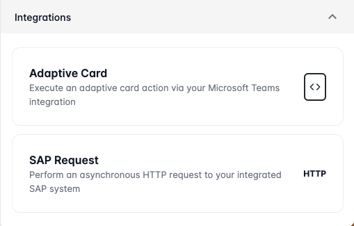

# Using Integrations

Integrations in Looply open the door to a new dimension of efficiency by allowing users to weave external services into their workflows. This means your workflows can now tap into the unique capabilities of integrated services, turning routine tasks into streamlined processes. In this documentation, we'll guide you through the steps of accessing and utilizing these integrations within your Looply workflows, empowering you to achieve more with every step.

Integration actions we currently support:&#x20;

* [Microsoft - Adaptive Card Actions](adaptive-card-actions.md)
* [SAP - HTTP Requests](sap-requests.md)

#### Adding Integrations

You can locate supported integration actions below the **Integrations** section of the Workflow Toolbox.&#x20;

<figure><figcaption></figcaption></figure>

Add any of our integration actions to your workflow by simply clicking on the action.&#x20;
