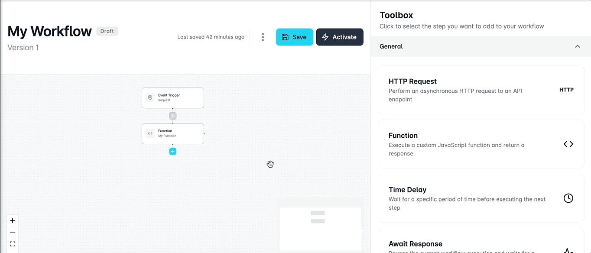
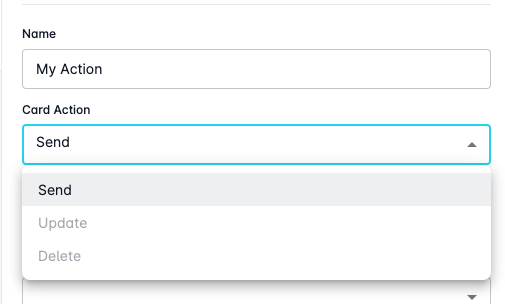
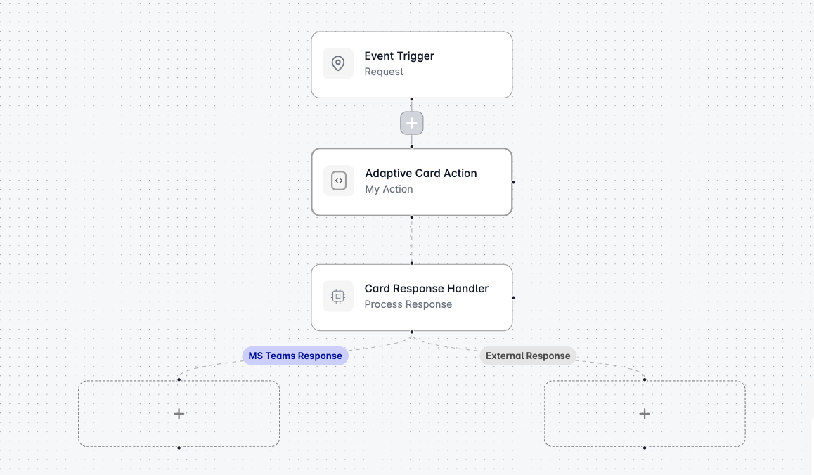
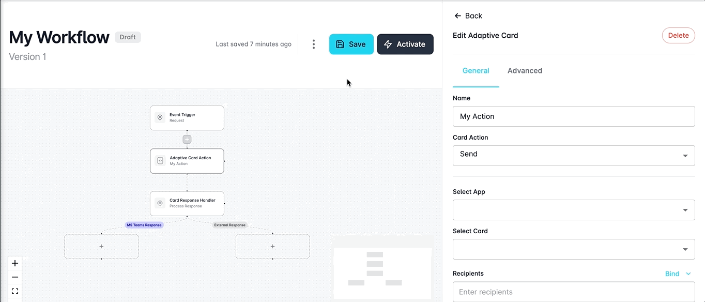

# Adaptive Card Actions

Adaptive Card Actions provide a direct avenue for users to harness the full potential of their Microsoft integration within workflows.&#x20;

Specifically designed for efficiency, these steps empower users to send, update, or delete Adaptive Cards seamlessly using their integrated Microsoft account and Looply-created apps.&#x20;

Imagine the ability to notify users of events within your system or process by incorporating Adaptive Card Actions into your workflow. It's a precise, no-nonsense approach to integrating Adaptive Cards that aligns seamlessly with your communication and notification needs.

## Configuring Actions

You can get started configuring your adaptive card action by clicking on a **+** button in your workflow and selecting the **Adaptive Card Action** step from the Workflow's toolbox.  &#x20;

<figure><figcaption></figcaption></figure>

### Sending Adaptive Cards

You can instruct your workflow to send an adaptive card by using the **Card Action** dropdown menu and selecting **Send**.&#x20;

<figure><figcaption></figcaption></figure>

#### App Selection

For every adaptive card action you wish to carry out with Looply, you'll need to define the Microsoft Teams app you want to use to process the action.&#x20;

Use the **Select App** dropdown to select which Looply-created Microsoft Teams app you wish to use to dispatch your adaptive card.&#x20;

#### Card Selection

You can use the **Select New Card** dropdown menu to select the Adaptive Card you wish to send to the user.&#x20;

Additionally, if you haven't created any adaptive cards yet or wish to create a new adaptive card to be used - you can select '**create a new adaptive card**' from the dropdown menu. Once selected, a new adaptive card instance will be created and automatically inserted to be used within your adaptive card action.&#x20;

See [building-adaptive-cards](../../adaptive-cards/building-adaptive-cards/ "mention") to learn more about creating or editing adaptive cards.&#x20;

#### Recipients

Use the **Recipients** input field to determine which users should receive the adaptive card.&#x20;

You can choose to enter your recipients manually or use the dropdown to access data from your event trigger or existing steps.&#x20;


**Tip:** When manually entering a recipient, ensure accuracy by using their Microsoft username. This guarantees a seamless connection between Looply and your Microsoft account, ensuring the intended recipient receives the notification promptly.\
\
For example: `USERNAME@x3qlj.onmicrosoft.com`


### Updating Adaptive Cards

You can instruct your workflow to update an adaptive card that was previously dispatched by using the **Card Action** dropdown menu and selecting **Update**.&#x20;

Updating adaptive cards can be useful for displaying new information to your user, for example, if the status of their notification has changed.&#x20;

#### Select Previous Card

To update an adaptive card, you'll first need to select the existing card that was dispatched and should now be updated.&#x20;

Use the **Select Existing Card** dropdown menu to select the previous card from your workflow that you want to update.&#x20;

#### Select New Card

Use the **Select New Card** dropdown menu to select the new adaptive card that you wish to replace the previous one.&#x20;

### Deleting Adaptive Cards

Additionally, you can use Adaptive Card Action steps to delete previously dispatched adaptive cards to prevent the recipient from being able to view or access them.&#x20;

This can be useful if you want your notification to expire or no longer require it for a user.&#x20;

You can instruct your workflow to delete an adaptive card that was previously dispatched by using the **Card Action** dropdown menu and selecting **Delete**.&#x20;

#### Select Previous Card

Use the **Select Existing Card** dropdown menu to select the previous card from your workflow that you want to delete.&#x20;

### Notifying Users

When updating or deleting an adaptive card which has been dispatched to a user, you can configure the action to notify the user by toggling the **Notify User** switch from the configuration options.&#x20;

This can be useful when you want the recipient to be made aware of the update or deletion of the adaptive card they previously received.&#x20;

By using the notify user setting, when an update action is processed - the existing card will be deleted and a new one will be dispatched which will ensure the updated notification is pushed to the front of their Teams chat messages. Similarly, when a delete action is processed - a new notification will be issued to the user informing them that the previous message has been deleted.&#x20;

## Handling Responses

You can instruct your Looply workflow to accept and handle a response from a user when sending adaptive cards. This is often used in workflows where the recipient is expected to respond to the adaptive card using buttons located on the card. For example, approving or rejecting an event.&#x20;

#### Allowing Responses

When using Adaptive Card Action steps to send a new card to a user, you can add support for accepting a response by toggling the **Allow Responses (Teams)** or **Allow Responses (External)** switch.&#x20;

When you allow responses, the Adaptive Card Action step within your workflow will immediately insert a new **Card Response Handler** block, followed by separate branches to handle a response from Microsoft Teams (directly from the adaptive card) or an external response.&#x20;

### Card Response Handler

Card Response Handler blocks are inserted in your workflow when you choose to allow responses from your Adaptive Card send action.&#x20;

These handlers operate by keeping your workflow in a processing state while they wait for a response to be received. Currently, our Card Response Handlers support responses directly from the adaptive card or alternatively an external response from outside your adaptive card.&#x20;

<figure><figcaption></figcaption></figure>

### MS Teams Response

The **MS Teams Response** branch can be used to handle a direct response from Microsoft Teams via your adaptive card. This is most commonly used to process button clicks for specific actions on your adaptive card.&#x20;

To begin creating your response, click on the placeholder step within the **MS Teams Response** branch and then select the workflow step you wish to insert here from the Toolbox.&#x20;

<figure><figcaption></figcaption></figure>

### External Response

Alternatively, you might want to handle a response or trigger from outside Microsoft Teams relating to the current process. This can be useful if your process has been updated from within a different system or workflow, and you need to update or delete the adaptive card.&#x20;

To handle an external response within your workflow, click on the placeholder step within the **External Response** branch and then select the workflow step you wish to insert here from the Toolbox.&#x20;

## Authenticating Actions

Adaptive Card Actions can be authenticated through a configured Looply integration destination that supports an end-user authentication method such as OAuth2.0 or Basic Authentication.&#x20;

### Adding Authentication

To add authentication to your adaptive card action, navigate to the **Advanced** tab within the Adaptive Card Action toolbox editor.&#x20;

From here, you can open the **Authentication** section and select the **Require Authentication** option.&#x20;

This will make the integration selection dropdown menu available where you can view a list of all available integrations that have been configured which support end-user authentication for this step. Simply, select the integration you want to use to authenticate your action.&#x20;

Now, when you execute your workflow and your adaptive card is sent - when the user attempts to execute an action on the card via action buttons they will be prompted to authenticate via the integration destination credentials supplied.&#x20;

### Using Authentication Response

Authentication response data is made available to any subsequent workflow steps from the Card Response Handler.&#x20;

This includes data such as bearer tokens and any other metadata returned from the authentication process.&#x20;

This data can then be used to authenticate subsequent steps, such as HTTP Requests to the same integration client API.&#x20;
